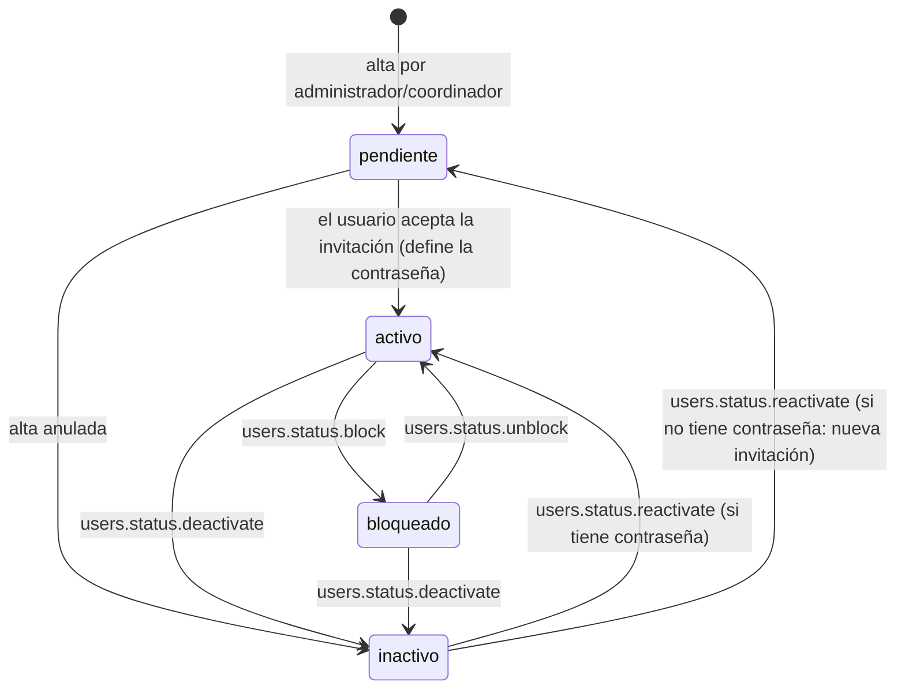

# B — Modelo de identidad

## 1. Entidades y su significado

| Concepto | Representación en `cieu` | Clase |
|---|---|---|
| **Cuenta** | Una fila de `usuario`. Identificador interno `usuarioid BIGINT`. | [C] |
| **Credencial local** | `usuario.password_hash` (Argon2id, formato PHC). NULL significa que no hay credencial. | [C] / [P] |
| **Rol** | Fila de `rol`; `rol.nombre` es el **código estable** en mayúsculas: `ADMINISTRADOR`, `COORDINADOR`, `MENTOR`, `EMPRENDEDOR`. | [P] |
| **Permiso** | Fila de `permiso`; `permiso.nombre` es el **código estable** `dominio.accion[.alcance]` (C §1). | [P] |
| **Rol de un usuario** | Fila de `rol_usuario`. Un usuario puede tener N roles; el par `(rolid, usuarioid)` es único (`uq_rol_usuario_rolid_usuarioid`). | [C] |
| **Emprendedor** | Fila de `emprendedor` con `usuarioid` único: es el perfil de negocio de una cuenta con rol `EMPRENDEDOR`. | [C] |
| **Mentor** | **No hay tabla propia.** Mentor = cuenta con rol `MENTOR`. Su vínculo con emprendimientos son las filas de `asignaciones`. | [C] |
| **Sesión** | Fila de `sesion_usuario` (tabla nueva, E-H §2). | [P] |

## 2. Estados de la cuenta (`usuario.estado`)

### 2.1 Vocabulario canónico [P]

| Valor | Significado | ¿Puede iniciar sesión? | ¿Sesiones válidas? |
|---|---|---|---|
| `pendiente` | Creada, sin activar: invitación enviada y sin contraseña aún. | No | No |
| `activo` | Operativa. | Sí | Sí |
| `bloqueado` | Suspendida por **motivo de seguridad** (sospecha de compromiso, abuso). Solo la revierte quien tenga `users.status.unblock`. | No | No (se revocan) |
| `inactivo` | Baja de negocio (terminó el programa, dejó la institución). Se conservan su historial y sus datos. | No | No (se revocan) |

- **[P]** Valores en minúsculas y sin espacios. Se comparan siempre con
  `lower(btrim(estado))`, para tolerar datos insertados a mano (precedente H-10).
- **[P]** Cualquier otro valor, incluido `NULL`, se trata como **no activo**.
- **[P] Migración incremental** `usuario_estado_vocabulario` (módulo `users`):
  1. `UPDATE usuario SET estado = lower(btrim(estado))`.
  2. Valores NULL o fuera del vocabulario → `inactivo`. Si la tabla no está
     vacía, la migración **aborta** y lista los registros afectados en lugar de
     reinterpretarlos en silencio.
  3. `ALTER COLUMN estado SET DEFAULT 'pendiente'`, `SET NOT NULL`.
  4. `CHECK (estado IN ('pendiente','activo','bloqueado','inactivo'))`, con nombre
     `ck_usuario_estado`.
  > Toca una columna creada por la baseline: se hace **solo** con una migración
  > nueva. Requiere aprobación explícita (riesgo R-05). Si no se aprueba, se
  > aplica únicamente la regla de falla cerrado en la aplicación.

### 2.2 Transiciones permitidas [P]

Cualquier otra transición devuelve `409 invalid_status_transition`.

Efectos de pasar a `bloqueado` o `inactivo`:

- Las sesiones abiertas dejan de servir **en el siguiente request**, porque el
  `Principal` exige `activo`.
- En el primer intento de refresh posterior, la sesión se marca revocada con
  `motivo_revocacion = 'cuenta_deshabilitada'`.
- Los tokens de invitación y restablecimiento pendientes quedan inválidos, porque
  la validación también exige el estado correcto.
- Los roles **no** se eliminan. Al reactivar, el usuario recupera los mismos roles.

## 3. Correo electrónico [P]

- Se normaliza con `email.strip().lower()` antes de guardar y de buscar. No se
  quitan puntos ni sufijos `+tag`: no hay garantía de que el proveedor
  institucional los ignore.
- Validación: el `EmailStr` de Pydantic necesita el paquete `email-validator`, que
  **no está instalado** [C]. Se usa una validación sintáctica propia en
  `schemas.py` (RFC 5321 simplificado: longitud ≤ 254, una sola `@`, dominio con
  punto, sin espacios) para no añadir una dependencia.
- **Migración incremental** `usuario_email_lower`: índice único
  `uq_usuario_email_lower ON usuario (lower(email))`. Se conserva
  `uq_usuario_email` de la baseline. Antes de crearlo se comprueba que no haya
  duplicados por mayúsculas; si los hay, la migración aborta.
- Dominio institucional obligatorio para el correo: **pendiente** (N-02). Por
  defecto se acepta cualquier dominio.

## 4. Creación de cuentas

### 4.1 Quién crea qué [P] / [D]

| Rol que recibe la cuenta | Quién puede crearla | Mecanismo | Permisos requeridos al actor |
|---|---|---|---|
| `ADMINISTRADOR` (el primero) | Operador con acceso a la terminal del servidor | CLI `create-admin` (flujo 1) | — (acceso a la máquina y a `DATABASE_URL`) |
| `ADMINISTRADOR` (siguientes) | Un administrador activo | `POST /users` + invitación | `users.create` + `roles.assign.administrador` |
| `COORDINADOR` | Un administrador | `POST /users` + invitación | `users.create` + `roles.assign.coordinador` |
| `MENTOR` | Un administrador. El coordinador queda **pendiente** (N-05) | `POST /users` + invitación | `users.create` + `roles.assign.mentor` |
| `EMPRENDEDOR` | Un administrador o coordinador | `POST /users` + invitación; el perfil se crea con `POST /entrepreneurs` (§6) | `users.create` + `roles.assign.emprendedor` |

- **[P] No existe registro público.** No hay ningún endpoint sin autenticación que
  cree filas en `usuario`, salvo la aceptación de una invitación ya emitida, que
  **activa** una cuenta existente y nunca asigna roles.
- **[P] Toda cuenta nace en `pendiente`**, con `password_hash = NULL` y al menos un
  rol. El backend rechaza `roles: []` (`422`).
- **[P] No hay contraseñas predeterminadas ni elegidas por el administrador.** La
  contraseña la define siempre la persona dueña de la cuenta, a través del enlace
  de invitación. Así el administrador nunca conoce la credencial.
- **[D]** El autorregistro de emprendedores con correo institucional no se
  implementa (N-01). Si el CIE-U lo aprueba, solo podrá crear cuentas `pendiente`
  con rol `EMPRENDEDOR` y requerirá la aprobación de un coordinador.

### 4.2 Primer administrador [P]

- Comando: `uv run python -m emprendeu.modules.auth.cli create-admin --email <e> --nombre <n> --apellido <a>`.
- La contraseña se pide **interactivamente**, dos veces, con `getpass`. Nunca por
  argumento, variable de entorno ni archivo, para que no quede en el historial del
  shell, en `ps` ni en los logs. Se aplica la política de contraseñas (§5.2).
- Se niega si ya existe **algún** usuario con el rol `ADMINISTRADOR` en estado
  `activo` o `bloqueado`. Hay una opción de emergencia, `--break-glass`, que exige
  escribir el correo de confirmación y deja una entrada de auditoría
  `auth.admin.break_glass`.
- La cuenta se crea **directamente `activo`**, con el rol `ADMINISTRADOR`, en una
  sola transacción. Auditoría `users.admin.bootstrap` con `usuarioid = NULL` (sin
  actor HTTP).
- Requiere que la migración de siembra de roles y permisos (C §2) esté aplicada.
  Si `rol` no contiene `ADMINISTRADOR`, el comando aborta.

## 5. Credenciales

### 5.1 Almacenamiento [C] / [P]

- **[C]** `pwdlib.PasswordHash.recommended()` = Argon2id con los parámetros de
  argon2-cffi (t=3, m=64 MiB, p=4, sal de 16 bytes, hash de 32 bytes).
- **[P]** Se usa `verify_and_update`: si los parámetros cambian, el hash se rehace
  al iniciar sesión con éxito.
- **[P]** El hash se calcula en un hilo (`anyio.to_thread.run_sync`), para no
  bloquear el event loop (regla 8 del backend). Un `CapacityLimiter` de **4**
  hilos concurrentes de hashing (configurable) acota la memoria: 4 × 64 MiB.
- **[P]** Pepper/HMAC adicional: **no**. Argon2id con sal por usuario es suficiente
  para el modelo de amenaza, y un pepper añade una clave que custodiar y rotar.

### 5.2 Política de contraseñas [P] / [D]

Basada en NIST SP 800-63B; los valores son configurables por entorno:

| Regla | Valor por defecto |
|---|---|
| Longitud mínima | 12 caracteres (`PASSWORD_MIN_LENGTH`) |
| Longitud máxima | 128 caracteres; además, el valor en UTF-8 debe ocupar como mucho 1024 bytes, para evitar un DoS con entradas enormes |
| Composición obligatoria (mayúsculas, símbolos...) | **No** |
| Lista de bloqueo | Unas 1000 contraseñas comunes, en un archivo de datos del módulo `auth`; además no puede contener la parte local del correo, el nombre ni el apellido (sin distinguir mayúsculas) |
| Distinta de la actual | Sí, al cambiarla |
| Caducidad periódica | **No** (NIST desaconseja la rotación forzada) |
| Normalización | Unicode NFKC antes de calcular el hash |

**[D]** Si el CIE-U tiene una política institucional, prevalece sobre esta (N-08).

### 5.3 Contraseña nula [P]

| Situación | Comportamiento |
|---|---|
| `password_hash IS NULL` y `estado = pendiente` | Login → `401 invalid_credentials` (genérico). La única salida es aceptar la invitación. |
| `password_hash IS NULL` y `estado = activo` | **Estado inconsistente**, solo posible con datos manuales. Login → `401 invalid_credentials`. Se escribe una entrada de auditoría `auth.login.null_password` para que un administrador lo corrija enviando un restablecimiento. |
| `password_hash IS NULL` y `bloqueado` o `inactivo` | Login → `401 invalid_credentials`. |
| Cualquier caso con hash NULL | Se ejecuta igualmente una verificación Argon2 contra un hash ficticio, para igualar el tiempo de respuesta y no revelar la existencia de la cuenta. |
| `forgot-password` con hash NULL y estado `activo` | Se envía el enlace de restablecimiento. Es la vía de reparación del caso inconsistente. |

**[D]** Si en el futuro hay SSO institucional (N-03), `password_hash IS NULL`
pasará a significar "solo SSO", y esta tabla se revisará.

## 6. Vinculación con emprendedor y mentor

### 6.1 Emprendedor [P]

- Una cuenta con el rol `EMPRENDEDOR` **puede tener** un perfil en `emprendedor`.
  `uq_emprendedor_usuarioid` garantiza que sea como mucho uno.
- El perfil lo crea el módulo `entrepreneurs` (`POST /entrepreneurs`, con su propia
  fase), que comprueba a través del servicio público de `users` que la cuenta
  tenga el rol `EMPRENDEDOR`. Dependencia `entrepreneurs → users`.
- Para que el alta sea atómica, `POST /entrepreneurs` acepta los datos de la
  cuenta y llama a `users.service.create_user(...)` **en la misma transacción**
  (misma `AsyncSession`, una sola confirmación al final del servicio
  orquestador). En esta fase de identidad solo se especifica el contrato. Su
  implementación pertenece a la fase de `entrepreneurs` (N-17).
- `emprendedor.estado` usa el vocabulario `activo | inactivo`, en minúsculas, y es
  **independiente** de `usuario.estado`. El alcance `own` exige que los dos estén
  activos (C-D §7.2).
- La pertenencia a un emprendimiento es una fila de `emprendimiento_emprendedores`;
  la gestiona el coordinador (`ventures.members.manage`).

### 6.2 Mentor [P]

- Ser mentor es tener el rol `MENTOR`. No se crea ninguna tabla.
- Su acceso a un emprendimiento existe **solo** mientras tenga una fila en
  `asignaciones` vigente (C-D §7.1). Las asignaciones las gestiona el coordinador
  (`mentoring.assignments.manage`) en la fase de `mentoring`.
- **[D]** Mentores externos a la universidad, con o sin correo institucional:
  N-06.

## 7. Roles: asignación, revocación y roles múltiples

### 7.1 Reglas [P]

1. Para **asignar o revocar** el rol `R`, el actor necesita `roles.assign.<r>`,
   donde `<r>` es el nombre del rol en minúsculas.
2. **Regla de dominancia:** para gestionar al usuario `T` (editarlo, cambiar su
   estado, sus roles o sus sesiones, o enviarle un restablecimiento), el actor
   necesita `roles.assign.<r>` **para cada rol `r` que ya tenga `T`**. Por ejemplo,
   un coordinador no puede desactivar a un mentor ni a un administrador.
3. **Nadie gestiona sus propios roles ni su propio estado.** Se responde
   `403 self_management_forbidden`. Evita la autoescalada y el autobloqueo.
4. **Último administrador:** no se puede revocar el rol `ADMINISTRADOR` ni pasar a
   `bloqueado` o `inactivo` a un administrador si eso deja **cero** cuentas
   `activo` con ese rol. Se responde `409 last_admin`. La comprobación se
   serializa con `SELECT ... FOR UPDATE` sobre la fila del rol `ADMINISTRADOR`
   en la misma transacción, para evitar la carrera entre dos revocaciones
   simultáneas.
5. Asignar un rol que ya se tiene es idempotente (`200` con el estado actual, sin
   auditar). Revocar uno que no se tiene devuelve `404 not_found`.
6. **No puede quedarse sin roles** un usuario `activo`: revocar el último rol
   devuelve `409 last_role`. Para retirar a alguien, se desactiva.
7. Asignar `EMPRENDEDOR` no crea el perfil `emprendedor` (§6.1); la UI enlaza a
   ese paso.
8. Un cambio de roles **no** revoca sesiones, porque los permisos se leen de la BD
   en cada request. Se audita `users.role.assigned` o `users.role.revoked`.

### 7.2 Varios roles [P]

- **Permisos efectivos** = unión de los permisos de todos los roles del usuario.
  Solo se calculan si la cuenta está `activo`.
- El alcance se evalúa por permiso: tener `ventures.read.assigned` (mentor) y
  `ventures.read.own` (emprendedor) permite leer la unión de los dos conjuntos.
- **[D]** Conflicto de interés, el caso de un mentor asignado a un emprendimiento
  del que es miembro: el diseño propone que el servicio de asignaciones lo
  **rechace** (`409 conflict_of_interest`) cuando llegue su fase. Lo confirma el
  CIE-U (N-09).
- **[P]** La UI muestra todos los roles. No hay "cambio de rol activo": toda la
  navegación se deriva de los permisos efectivos.

## 8. Historial y desactivación

- **[P] Nunca se borran filas de `usuario` a través de la API.** Además,
  `fk_bitacora_usuarioid ON DELETE RESTRICT` lo impide en cuanto el usuario tiene
  auditoría [C].
- **[P]** Desactivar conserva los roles, el perfil `emprendedor`, las asignaciones
  (que ya no conceden acceso, porque la cuenta no está activa) y las sesiones
  revocadas, durante la retención de E-H §2.5.
- **[P]** Cada cambio de estado, rol, datos de perfil o credencial escribe en
  `bitacora`:

  | Campo | Contenido |
  |---|---|
  | `usuarioid` | El actor (NULL si es la CLI o un evento anónimo) |
  | `accion` | Código de evento estable (G §0.4) |
  | `tabla` | `usuario`, `rol_usuario`, `sesion_usuario`... |
  | `id_registro` | El id afectado, como texto |
  | `datos_anteriores` / `datos_nuevos` | JSON **solo** con los campos que cambian. **Nunca** `password_hash`, tokens, hashes de token ni contraseñas. |
  | `ip` | La IP del cliente, resuelta según E-H §7 |
  | `fecha` | `now()` en UTC, fijada explícitamente (H-09) |

- **[D]** Anonimización o "derecho al olvido": la legislación aplicable y su
  procedimiento son decisiones del CIE-U (N-12). El diseño no incluye borrado.

## 9. Recuperación de credenciales (resumen; detalle en el flujo I-11)

- **[P]** `POST /auth/password/forgot` responde **siempre `202`** con el mismo
  cuerpo. El correo se envía en una `BackgroundTask`, para que el tiempo de
  respuesta no dependa de si la cuenta existe.
- **[P]** Token opaco de 256 bits, de un solo uso, que caduca en **30 min**. En la
  BD solo se guarda su SHA-256 (tabla `token_cuenta`, E-H §2.3). Emitir uno nuevo
  invalida los anteriores del mismo propósito.
- **[P]** Restablecer la contraseña revoca **todas** las sesiones (motivo
  `restablecimiento`), notifica al correo y no inicia sesión automáticamente.
- **[P]** Límite: 3 solicitudes por cuenta cada hora y 10 por IP cada hora. Si se
  excede, se sigue respondiendo `202` pero no se envía el correo.
- **[P]** Las invitaciones usan el mismo mecanismo, con el propósito `invitacion`
  y una caducidad de **72 h** [D: N-11].
