# E — Modelo de datos · H — Sesiones, JWT y transporte de credenciales

## 1. Diagrama entidad-relación

Las tablas existentes **[C]** se muestran con sus columnas reales. Las nuevas **[P]**
llevan el sufijo `«nueva»`. Ninguna PK del dominio cambia: todas siguen siendo
`BIGINT GENERATED BY DEFAULT AS IDENTITY`.

```mermaid
erDiagram
  usuario ||--o{ rol_usuario : "tiene"
  rol ||--o{ rol_usuario : "se asigna en"
  rol ||--o{ rol_permiso : "agrupa"
  permiso ||--o{ rol_permiso : "se concede en"
  usuario ||--o| emprendedor : "perfil (uq usuarioid)"
  emprendedor ||--o{ emprendimiento_emprendedores : "es miembro"
  emprendimiento ||--o{ emprendimiento_emprendedores : "tiene miembros"
  usuario ||--o{ asignaciones : "asignado (mentor/coord)"
  emprendimiento ||--o{ asignaciones : "recibe"
  usuario |o--o{ bitacora : "actor"
  usuario ||--o{ sesion_usuario : "abre «nueva»"
  sesion_usuario ||--o{ token_refresco : "rota «nueva»"
  usuario ||--o{ token_cuenta : "invitación/reset «nueva»"
  usuario |o--o{ intento_login : "intentos «nueva»"

  usuario {
    bigint usuarioid PK
    varchar120 apellido "NOT NULL"
    varchar254 email "NOT NULL, uq_usuario_email (+ uq lower(email) [P])"
    varchar40 estado "NULL hoy -> NOT NULL + CHECK [P]"
    timestamptz fecha_actualizacion
    timestamptz fecha_registro "DEFAULT now"
    varchar160 nombre "NOT NULL"
    varchar255 password_hash "NULL = sin credencial"
    varchar35 telefono
  }
  rol {
    bigint rolid PK
    text descripcion
    varchar160 nombre "uq_rol_nombre: código estable"
  }
  permiso {
    bigint permisoid PK
    varchar160 nombre "uq_permiso_nombre: código estable"
    text descripcion "[P] nueva columna"
  }
  rol_usuario {
    bigint rol_usuarioid PK
    bigint rolid FK
    bigint usuarioid FK
  }
  rol_permiso {
    bigint rol_permisoid PK
    bigint permisoid FK
    bigint rolid FK
  }
  emprendedor {
    bigint emprendedorid PK
    varchar50 documento_identidad
    varchar40 estado
    timestamptz fecha_registro
    bigint usuarioid FK "uq"
  }
  emprendimiento {
    bigint emprendimientoid PK
    varchar160 nombre
    varchar40 estado
    varchar120 sector
    timestamptz fecha_inicio
  }
  emprendimiento_emprendedores {
    bigint emprendimiento_emprendedoresid PK
    timestamptz fecha_ingreso
    varchar100 rol_en_emprendimiento
    bigint emprendedorid FK
    bigint emprendimientoid FK
    timestamptz fecha_salida "[P] N-17"
  }
  asignaciones {
    bigint asignacionesid PK
    varchar40 estado
    timestamptz fecha_inicio
    timestamptz fecha_fin "ck fin >= inicio"
    varchar80 tipo_asignacion
    bigint usuarioid FK
    bigint emprendimientoid FK
  }
  bitacora {
    bigint bitacoraid PK
    varchar120 accion
    jsonb datos_anteriores
    jsonb datos_nuevos
    timestamptz fecha "sin DEFAULT"
    varchar45 ip
    varchar120 tabla
    bigint usuarioid FK "NULL-able"
    varchar250 id_registro
  }
  sesion_usuario {
    bigint sesion_usuarioid PK
    uuid sid "uq, claim sid = familia"
    bigint usuarioid FK
    varchar10 tipo_cliente "web|movil"
    timestamptz fecha_creacion
    timestamptz fecha_ultimo_uso
    timestamptz fecha_expiracion "absoluta"
    timestamptz fecha_revocacion
    varchar30 motivo_revocacion
    bigint revocada_por FK
    varchar45 ip_creacion
    varchar45 ip_ultimo_uso
    varchar255 agente_usuario
    varchar100 nombre_dispositivo
  }
  token_refresco {
    bigint token_refrescoid PK
    bigint sesion_usuarioid FK
    varchar64 hash_token "uq, SHA-256 hex"
    timestamptz fecha_emision
    timestamptz fecha_expiracion
    timestamptz fecha_uso
    bigint reemplazado_por FK
  }
  token_cuenta {
    bigint token_cuentaid PK
    bigint usuarioid FK
    varchar20 proposito "invitacion|restablecimiento"
    varchar64 hash_token "uq"
    timestamptz fecha_emision
    timestamptz fecha_expiracion
    timestamptz fecha_uso
    timestamptz fecha_invalidacion
    bigint creado_por FK
    varchar45 ip_solicitud
  }
  intento_login {
    bigint intento_loginid PK
    varchar64 email_hmac
    bigint usuarioid FK "NULL si no existe"
    varchar45 ip
    boolean exitoso
    timestamptz fecha
  }
```



### 1.1 Nombres [P]

Las tablas y columnas nuevas siguen la convención del esquema `cieu`: en español,
minúsculas y PK `<tabla>id`. Es la excepción de la regla global §4.9. Se evita la
palabra suelta `sesion`, porque ya existe `sesiones_acompanamiento` (mentoría).

### 1.2 Propiedad de las tablas nuevas [P]

Todas pertenecen al **módulo nuevo `auth`** (`modules/auth/models.py`), que se
registra en `db/metadata.py` y en la tabla de módulos del `AGENTS.md` del
backend: con él, `auth` pasa a ser el módulo 12 y hay 42 tablas.

### 1.3 Migraciones incrementales [P]

La baseline `cfed9e8e2430` **no se toca**. Cada migración nueva se genera con
`--autogenerate`, se revisa a mano y se valida con `alembic check` + `pg_dump`
(regla 12 del backend).

| Orden | Mensaje | Módulo | Contenido | Aprobación |
|---|---|---|---|---|
| 1 | `seed roles y permisos` | users | Datos: 4 roles, el catálogo de C §3 y las filas `✔` de `rol_permiso`. | Con la fase |
| 2 | `usuario estado y email normalizado` | users | `usuario.estado`: vocabulario, `NOT NULL`, `DEFAULT 'pendiente'`, `ck_usuario_estado`; `uq_usuario_email_lower`; `permiso.descripcion`. | Explícita (R-05) |
| 3 | `tablas de sesiones y tokens` | auth | `sesion_usuario`, `token_refresco`, `token_cuenta`, `intento_login`. | Con la fase |
| 4 | `fecha de salida de miembros` | entrepreneurs | `emprendimiento_emprendedores.fecha_salida TIMESTAMPTZ NULL` + `ck_emprendimiento_emprendedores_fechas`. | **N-17**, toca otro módulo |

## 2. Modelo de sesiones

### 2.1 `sesion_usuario` [P]

Una fila = un inicio de sesión en un dispositivo o navegador = **una familia de refresh tokens**.

| Columna | Tipo | Nulo | Notas |
|---|---|---|---|
| `sesion_usuarioid` | `BIGINT IDENTITY` | no | PK interna, coherente con el resto del esquema. **No sale de la API.** |
| `sid` | `UUID` | no | `uq_sesion_usuario_sid`. Se genera en la aplicación con `uuid.uuid4()` (122 bits aleatorios de `os.urandom`). Es el claim `sid` y el identificador público de la sesión (`DELETE /auth/sessions/{sid}`). **Es también el identificador de familia**: rotar un refresh no cambia el `sid`. |
| `usuarioid` | `BIGINT` | no | `fk_sesion_usuario_usuarioid → usuario ON DELETE RESTRICT`. |
| `tipo_cliente` | `VARCHAR(10)` | no | `ck_sesion_usuario_tipo_cliente IN ('web','movil')`. Determina los TTL (§3.1). |
| `fecha_creacion` | `TIMESTAMPTZ` | no | `DEFAULT CURRENT_TIMESTAMP`. |
| `fecha_ultimo_uso` | `TIMESTAMPTZ` | sí | Se actualiza **solo en cada refresh**, no en cada request, para no escribir en cada lectura. |
| `fecha_expiracion` | `TIMESTAMPTZ` | no | Caducidad **absoluta** (`fecha_creacion + absoluta_<cliente>`); no se extiende nunca. |
| `fecha_revocacion` | `TIMESTAMPTZ` | sí | NULL = no revocada. |
| `motivo_revocacion` | `VARCHAR(30)` | sí | `ck_sesion_usuario_motivo IN ('logout','logout_global','cambio_contrasena','restablecimiento','reutilizacion_detectada','revocacion_admin','cuenta_deshabilitada','cambio_email')`. |
| `revocada_por` | `BIGINT` | sí | `fk_sesion_usuario_revocada_por → usuario`, cuando la revoca un administrador. |
| `ip_creacion` | `VARCHAR(45)` | sí | IPv4 o IPv6 textual (§7). |
| `ip_ultimo_uso` | `VARCHAR(45)` | sí | La del último refresh. |
| `agente_usuario` | `VARCHAR(255)` | sí | `User-Agent` truncado a 255. Solo informativo: **nunca** se usa para decidir. |
| `nombre_dispositivo` | `VARCHAR(100)` | sí | Etiqueta opcional enviada por el móvil (p. ej., "Pixel 8"). Se limpia de caracteres de control. |

Restricciones e índices:

- `ck_sesion_usuario_expiracion CHECK (fecha_expiracion > fecha_creacion)`.
- `ck_sesion_usuario_revocacion CHECK ((fecha_revocacion IS NULL) = (motivo_revocacion IS NULL))`.
- `ix_sesion_usuario_usuarioid (usuarioid)`.
- `ix_sesion_usuario_activas (usuarioid) WHERE fecha_revocacion IS NULL`: para
  `logout-all` y para listar las sesiones activas.

**Sesión válida** ⇔ `fecha_revocacion IS NULL AND fecha_expiracion > now()` y el
usuario está `activo`. La inactividad (*idle*) la controla la caducidad del
refresh token vigente (§2.2), no esta tabla.

### 2.2 `token_refresco` [P]

Historial de los refresh tokens emitidos dentro de una sesión.

| Columna | Tipo | Nulo | Notas |
|---|---|---|---|
| `token_refrescoid` | `BIGINT IDENTITY` | no | PK. |
| `sesion_usuarioid` | `BIGINT` | no | `fk_token_refresco_sesion_usuarioid → sesion_usuario ON DELETE CASCADE`: la purga de sesiones arrastra sus tokens. |
| `hash_token` | `VARCHAR(64)` | no | `uq_token_refresco_hash_token`. SHA-256 en hexadecimal del token. Basta un hash rápido porque el token tiene 256 bits de entropía: no se puede atacar por diccionario. |
| `fecha_emision` | `TIMESTAMPTZ` | no | `DEFAULT CURRENT_TIMESTAMP`. |
| `fecha_expiracion` | `TIMESTAMPTZ` | no | `min(emision + idle_<cliente>, sesion.fecha_expiracion)`. |
| `fecha_uso` | `TIMESTAMPTZ` | sí | El momento en que se **consumió** al rotar. NULL = es el vigente. |
| `reemplazado_por` | `BIGINT` | sí | `fk_token_refresco_reemplazado_por → token_refresco`. |

- `ix_token_refresco_sesion_usuarioid (sesion_usuarioid)`.
- Invariante: en cada sesión hay **como mucho un** token con `fecha_uso IS NULL`.
  Índice único parcial `uq_token_refresco_vigente (sesion_usuarioid) WHERE fecha_uso IS NULL`.

### 2.3 `token_cuenta` [P]

Tokens de un solo uso para **invitación** (activar la cuenta y definir la primera
contraseña) y **restablecimiento**.

| Columna | Tipo | Nulo | Notas |
|---|---|---|---|
| `token_cuentaid` | `BIGINT IDENTITY` | no | PK. |
| `usuarioid` | `BIGINT` | no | FK → `usuario`. |
| `proposito` | `VARCHAR(20)` | no | `ck_token_cuenta_proposito IN ('invitacion','restablecimiento')`. |
| `hash_token` | `VARCHAR(64)` | no | `uq_token_cuenta_hash_token`, SHA-256 en hexadecimal. |
| `fecha_emision` | `TIMESTAMPTZ` | no | `DEFAULT CURRENT_TIMESTAMP`. |
| `fecha_expiracion` | `TIMESTAMPTZ` | no | Invitación 72 h, restablecimiento 30 min (configurable; N-11). |
| `fecha_uso` | `TIMESTAMPTZ` | sí | Se consumió. |
| `fecha_invalidacion` | `TIMESTAMPTZ` | sí | Lo sustituyó un token nuevo del mismo propósito, o la cuenta cambió de estado. |
| `creado_por` | `BIGINT` | sí | FK → `usuario`: el administrador que lo emitió. NULL si lo pidió el propio usuario. |
| `ip_solicitud` | `VARCHAR(45)` | sí | — |

- `ix_token_cuenta_vigentes (usuarioid, proposito) WHERE fecha_uso IS NULL AND fecha_invalidacion IS NULL`.

### 2.4 `intento_login` [P]

Sirve para limitar la fuerza bruta **sin** cambiar `usuario` y **sin** guardar en
claro los correos de quien no tiene cuenta.

| Columna | Tipo | Nulo | Notas |
|---|---|---|---|
| `intento_loginid` | `BIGINT IDENTITY` | no | PK. |
| `email_hmac` | `VARCHAR(64)` | no | `HMAC-SHA256(AUTH_HMAC_KEY, email_normalizado)` en hexadecimal. Permite contar por cuenta aunque no exista, para que el límite no revele qué correos están registrados. |
| `usuarioid` | `BIGINT` | sí | Solo si la cuenta existe. FK → `usuario`. |
| `ip` | `VARCHAR(45)` | sí | — |
| `exitoso` | `BOOLEAN` | no | — |
| `fecha` | `TIMESTAMPTZ` | no | `DEFAULT CURRENT_TIMESTAMP`. |

- `ix_intento_login_email_fecha (email_hmac, fecha)`, `ix_intento_login_ip_fecha (ip, fecha)`.
- Un intento fallido se registra en una **transacción propia**, que se confirma
  antes de devolver el error: la transacción del request se revierte al
  propagarse la excepción.

### 2.5 Retención y purga [P] / [D]

| Datos | Se conservan | Mecanismo |
|---|---|---|
| `token_refresco` consumido o caducado | 30 días tras caducar | Comando `uv run python -m emprendeu.modules.auth.cli purge` (cron del sistema; N-25). |
| `sesion_usuario` revocada o caducada | 90 días | ídem (arrastra sus tokens por CASCADE). |
| `token_cuenta` usado, caducado o invalidado | 30 días | ídem. |
| `intento_login` | 30 días | ídem. |
| `bitacora` | Indefinidamente | Lo decide el CIE-U (N-12). |

### 2.6 Qué identificador usar en cada caso [P]

| Identificador | Tipo | Motivo |
|---|---|---|
| PK de las tablas nuevas | `BIGINT IDENTITY` | Coherencia con el esquema y el contrato §5. Nunca se expone. |
| `sid` (sesión y familia) | `UUID v4` | Se expone en el JWT y en `/auth/sessions/{sid}`: no debe ser enumerable. |
| `jti` (JWT) | `UUID v4` | Único por token y sin orden. No se persiste: la revocación es por `sid`. |
| Refresh token | 32 bytes de `secrets.token_bytes`, en base64url con el prefijo `eurt_` | El prefijo facilita los escáneres de secretos en logs y repositorios. |
| Token de invitación/reset | 32 bytes, base64url, con el prefijo `euat_` | ídem. |
| Id de usuario en la API | `BIGINT` (`usuarioid`) | Lo fija el contrato global. Es enumerable, pero la autorización es obligatoria en cada lectura, y a quien no tiene `users.read.all` se le responde 404 (C-D §9). |

## 3. Política de refresh tokens

### 3.1 Duraciones (configurables por entorno) [P] / [D N-11]

| Parámetro | Web | Móvil |
|---|---|---|
| Access token (`ACCESS_TOKEN_TTL_SECONDS`) | 900 s (15 min) | 900 s |
| Inactividad del refresh (`REFRESH_IDLE_<CLIENTE>`) | 7 días | 30 días |
| Caducidad absoluta de la sesión (`SESSION_ABSOLUTE_<CLIENTE>`) | 30 días | 90 días |
| Gracia por concurrencia (`REFRESH_REUSE_GRACE_SECONDS`) | 10 s | 10 s |

### 3.2 Rotación [P]

Cada `POST /auth/refresh` exitoso:

1. Calcula el `SHA-256` del token presentado y hace `SELECT ... FOR UPDATE` de la
   fila de `token_refresco` y de su `sesion_usuario`. Así, dos refresh simultáneos
   del mismo token se serializan.
2. Valida: el token existe; `fecha_uso IS NULL`; `fecha_expiracion > now()`; la
   sesión no está revocada y no ha caducado; el `tipo_cliente` del request coincide con
   el de la sesión; el usuario está `activo`.
3. Marca `fecha_uso = now()` y inserta el token nuevo con
   `reemplazado_por` apuntándolo.
4. Actualiza `sesion_usuario.fecha_ultimo_uso` e `ip_ultimo_uso`.
5. Emite un access token nuevo con el **mismo `sid`** y un `jti` nuevo.
6. Responde con el par nuevo. El token anterior queda inservible.

### 3.3 Detección de reutilización [P]

Si el token presentado **existe** y **ya tiene `fecha_uso`**:

| Condición | Interpretación | Acción |
|---|---|---|
| `now() - fecha_uso ≤ gracia` **y** su sucesor aún no se ha usado | Carrera legítima (dos pestañas, reintento por red) | `409 refresh_superseded`. **No** se revoca. El cliente vuelve a leer sus credenciales: en la web, las cookies ya están actualizadas (§5.3); en el móvil, el *single-flight* hace que no ocurra. |
| Cualquier otro caso | **Robo probable**: alguien tiene una copia de un token ya rotado | Se revoca la **sesión entera** (`motivo = reutilizacion_detectada`), se audita `auth.refresh.reuse_detected` con el `sid` y la IP, y se responde `401 invalid_refresh_token`. Atacante y víctima pierden la sesión; la víctima vuelve a iniciar sesión. |

Si el token **no existe** (inventado o purgado): `401 invalid_refresh_token`, sin
revocar nada. Así nadie puede cerrar sesiones ajenas enviando basura con un `sid`
conocido. Por eso el token no lleva el `sid` dentro (decisión DA-03).

### 3.4 Eventos que revocan sesiones [P]

| Evento | Sesiones revocadas | Motivo |
|---|---|---|
| `POST /auth/logout` | La actual | `logout` |
| `POST /auth/logout-all` | Todas las del usuario | `logout_global` |
| `DELETE /auth/sessions/{sid}` | Esa | `logout` |
| Cambio de contraseña | Todas **menos** la actual | `cambio_contrasena` |
| Restablecimiento de contraseña | Todas | `restablecimiento` |
| Un administrador cambia el correo | Todas | `cambio_email` |
| Revocación por un administrador | Todas | `revocacion_admin` |
| Reutilización detectada | Esa familia | `reutilizacion_detectada` |
| Cuenta `bloqueado`/`inactivo` | Todas, de forma perezosa: en el próximo refresh o en la próxima validación del access token | `cuenta_deshabilitada` |

### 3.5 Rechazo del access token de una sesión revocada [P]

Cada request protegido ejecuta, tras validar la firma y los claims:

```sql
SELECT s.tipo_cliente, u.estado
FROM cieu.sesion_usuario s
JOIN cieu.usuario u ON u.usuarioid = s.usuarioid
WHERE s.sid = :sid AND s.usuarioid = :sub
  AND s.fecha_revocacion IS NULL AND s.fecha_expiracion > now()
```

Sin fila, o con `lower(btrim(estado)) <> 'activo'` → `401 session_revoked`. Si la
cuenta está deshabilitada, la sesión se marca revocada en ese momento. Después se
cargan los permisos efectivos:

```sql
SELECT DISTINCT p.nombre FROM cieu.rol_usuario ru
JOIN cieu.rol_permiso rp ON rp.rolid = ru.rolid
JOIN cieu.permiso p ON p.permisoid = rp.permisoid
WHERE ru.usuarioid = :sub
```

Son dos consultas indexadas por request. **No hay caché** entre requests en esta
fase (R-06).

## 4. JWT (access token)

### 4.1 Algoritmo y claves [P]

- **HS256** (HMAC-SHA256) con `kid` en la cabecera. Justificación: DA-01. PyJWT no
  necesita `cryptography` para HS256 [C].
- `JWT_SIGNING_KEYS`: un objeto JSON en el entorno, `{"<kid>": "<secreto base64url>"}`;
  `JWT_ACTIVE_KID` indica cuál firma. Al arrancar se valida que:
  - cada secreto decodificado ocupe **≥ 32 bytes**;
  - `JWT_ACTIVE_KID` exista;
  - en `ENVIRONMENT=production` haya claves (no hay **ningún valor por
    defecto**: sin claves, la app no arranca).
- Se generan con `python -c "import secrets; print(secrets.token_urlsafe(48))"`.
  `.env.example` lleva la clave **vacía** con ese comentario.
- **Rotación planificada:** (1) añadir `kid` nuevo; (2) desplegar; (3) cambiar
  `JWT_ACTIVE_KID`; (4) esperar ≥ TTL del access + *leeway*; (5) retirar el `kid`
  viejo.
- **Compromiso de clave:** retirar el `kid` inmediatamente. Todos los access tokens
  dejan de valer, pero los refresh (opacos, en la BD) siguen siendo válidos: los
  clientes renuevan solos y nadie pierde la sesión.
- `AUTH_HMAC_KEY` (§2.4) es un secreto **distinto**, con las mismas reglas.

### 4.2 Cabecera y claims [P]

```json
// cabecera
{ "alg": "HS256", "typ": "at+jwt", "kid": "2026-10" }
// carga
{
  "iss": "emprendeu-api",
  "aud": "emprendeu-api",
  "sub": "42",
  "sid": "3f2b8c1e-6a8e-4f7a-9b1d-2c3e4f5a6b7c",
  "jti": "a1b2c3d4-e5f6-4a7b-8c9d-0e1f2a3b4c5d",
  "iat": 1792483200,
  "nbf": 1792483200,
  "exp": 1792484100,
  "token_type": "access"
}
```

| Claim | Valor | Validación |
|---|---|---|
| `iss` | `JWT_ISSUER` (por defecto `emprendeu-api`) | Igualdad exacta. |
| `aud` | `JWT_AUDIENCE` (por defecto `emprendeu-api`). La audiencia es **la API**, no el cliente. | Igualdad exacta. |
| `sub` | `usuarioid` como **cadena** (RFC 7519) | Solo dígitos, en el rango de BIGINT. |
| `sid` | UUID de la sesión | Formato UUID; debe existir y estar vigente en la BD (§3.5). |
| `jti` | UUID v4 | Formato UUID. No se persiste. |
| `iat` | emisión | Obligatorio; no puede estar en el futuro (más allá del *leeway*). |
| `nbf` | = `iat` | Obligatorio. |
| `exp` | `iat + ACCESS_TOKEN_TTL_SECONDS` | Obligatorio; `exp - iat ≤ ACCESS_TOKEN_TTL_SECONDS`. |
| `token_type` | `"access"` | Igualdad exacta. Junto a `typ: at+jwt` impide usar otro tipo de JWT como access token. |

**No se incluyen** nombre, correo, roles ni permisos. El JWT es un identificador;
la autorización la decide la BD (§3.5).

### 4.3 Validación estricta (orden) [P]

1. `Authorization` con el esquema exacto `Bearer` (sin distinguir mayúsculas) y un
   token de **≤ 4096 bytes**, con exactamente 3 segmentos.
2. `jwt.get_unverified_header`: `alg == "HS256"`, `typ == "at+jwt"`, `kid` ∈
   `JWT_SIGNING_KEYS`. Si no, `401 invalid_token`.
3. `jwt.decode(token, key[kid], algorithms=["HS256"], audience=..., issuer=...,
   leeway=10, options={"require": ["exp","iat","nbf","iss","aud","sub","jti","sid"]})`.
   La lista `algorithms` es **fija**: nunca se toma del token.
4. Comprobaciones propias: `token_type`, el formato de `sub` y `sid`, y `exp - iat`.
5. Consultas de sesión y permisos (§3.5).

`ExpiredSignatureError` → `401 token_expired`. Cualquier otro error → `401 invalid_token`.
Ninguno de los dos mensajes incluye el detalle de la excepción.

## 5. Transporte web (Next.js como BFF)

### 5.1 Cookies [P]

Las fija **solo el servidor Next**, nunca el navegador ni FastAPI:

| Cookie | Contenido | Atributos | `Max-Age` |
|---|---|---|---|
| `__Host-eu_at` | Access JWT | `HttpOnly; Secure; SameSite=Lax; Path=/` | `exp − now` |
| `__Host-eu_rt` | Refresh opaco | `HttpOnly; Secure; SameSite=Lax; Path=/` | La caducidad del refresh |

- El prefijo `__Host-` obliga a `Secure`, prohíbe `Domain` y exige `Path=/`: la cookie
  no se puede compartir con subdominios ni sobrescribirse desde ellos.
- `SameSite=Lax` (no `Strict`): un enlace de un correo a la app debe llegar con
  la sesión. Ninguna navegación GET cambia el estado (§5.4).
- `Path=/` en el refresh, porque `proxy.ts` necesita leerlo en cualquier ruta.
  El riesgo queda acotado porque es `HttpOnly` y solo el servidor Next lo lee.
- **Desarrollo** (`http://localhost`): el prefijo `__Host-` exige `Secure`. Chrome y
  Firefox aceptan cookies `Secure` en `localhost`; **hay que comprobar el
  comportamiento en el Safari que use el equipo** antes de implementar. Si
  falla, `lib/env.ts` usa nombres sin prefijo y `Secure=false` **solo** cuando
  `NODE_ENV=development` y el host es `localhost`.
- **Nunca** se guardan tokens en `localStorage`, `sessionStorage`, IndexedDB, Zustand
  (persistido o no) ni en props serializadas al cliente.

### 5.2 Llamadas al backend [P]

- `lib/api-client.ts` (`server-only`) lee `__Host-eu_at` con `cookies()` y llama a
  `API_BASE_URL/api/v1/...` con `Authorization: Bearer`. También reenvía
  `X-Forwarded-For` (la IP del navegador que ve Next) y `User-Agent` (§7).
- `features/auth/server/session.ts` expone `getSession()`, envuelta en `React.cache`
  para que haya una sola llamada a `GET /auth/me` por request. Devuelve el usuario,
  sus roles, sus permisos efectivos y la sesión. Los permisos sirven solo para
  **mostrar u ocultar** la UI: el backend vuelve a decidir en cada llamada.
- El layout de `(app)` llama a `getSession()`; si es `null`, hace `redirect('/login')`.
- **Cada Server Action vuelve a llamar a `requireSession()`**: la comprobación de la
  página no protege la acción, que es un punto de entrada aparte (docs de Next 16,
  `data-security.md`).
- Las Server Actions devuelven solo DTO validados con zod, **nunca** tokens.

### 5.3 Renovación (`proxy.ts`) [P]

```
matcher: todas las rutas excepto _next/static, _next/image, favicon, rutas (public) y /api/health

1. Si __Host-eu_at existe y su exp (decodificado SIN verificar, solo para decidir cuándo renovar) > now + 60 s → continuar.
2. Si no hay __Host-eu_rt → continuar (el layout de (app) redirige a /login si hace falta).
3. POST {API}/api/v1/auth/refresh  {refresh_token, client: "web"}  (+ X-Forwarded-For, User-Agent)
   200 → fijar las dos cookies en la respuesta Y reescribir la cabecera Cookie del
         request entrante (NextResponse.next({ request: { headers } })), para que el
         render de esta misma petición ya vea el access nuevo.
   409 refresh_superseded → 307 a la misma URL (el navegador reenvía con las cookies que
         acaba de recibir la otra pestaña). Una cookie "eu_rf=1; Max-Age=5" evita bucles:
         si ya está, se continúa sin renovar.
   401 → borrar las dos cookies y 307 a /session-expired?next=<ruta relativa>.
   error de red o 5xx → continuar sin tocar las cookies (el render mostrará el error).
```

- La decodificación sin verificar del paso 1 **no** autoriza nada: solo decide si
  conviene renovar. Quien valida la firma es el backend.
- `next` se valida como una ruta relativa interna (empieza por `/` y no por `//`),
  para evitar redirecciones abiertas.
- Antes de implementar hay que confirmar en `node_modules/next/dist/docs/` el runtime
  de `proxy.ts` y su soporte de `fetch` (regla 11 de la web).

### 5.4 Protección CSRF [P]

Defensa en capas, adaptada a que el backend no acepta cookies:

1. **El backend es inmune** por construcción: solo acepta `Authorization: Bearer`, que
   un navegador nunca añade solo. Sin CORS.
2. **Todas las mutaciones del navegador son Server Actions** (login, logout, cambio de
   contraseña, administración de usuarios). Next 16 solo las acepta por `POST` y compara
   `Origin` con `Host`/`X-Forwarded-Host` [C, docs]. `serverActions.allowedOrigins` se
   deja **vacío**.
3. **`SameSite=Lax`** en las cookies: no viajan en los POST *cross-site*.
4. **Route Handlers (`app/api/**/route.ts`)**: en esta fase **no** hay ninguno que
   mute. Si apareciera uno, debe empezar llamando a `assertSameOrigin(request)`
   (`lib/security.ts`), que exige `Origin == APP_ORIGIN` o
   `Sec-Fetch-Site: same-origin`. Un test recorre `app/api` y falla si un `POST`,
   `PUT`, `PATCH` o `DELETE` no la invoca.
5. **Las GET no cambian el estado**, ni en Next ni en el backend.
6. **Login CSRF** (forzar a la víctima a entrar con la cuenta del atacante): queda
   cubierto por (2), porque el login es una Server Action.

Si la evaluación de seguridad exige además un token sincronizador, se añadirá un
*double-submit* `__Host-eu_csrf` firmado con HMAC. No se incluye por defecto porque
no aporta protección frente a navegadores modernos con (2)+(3) y añade estado.

### 5.5 Cabeceras de seguridad (Next) [P]

`Content-Security-Policy` con nonce (guía `content-security-policy.md` de Next 16),
`frame-ancestors 'none'`, `Referrer-Policy: strict-origin-when-cross-origin`
(`no-referrer` en `/reset-password` y `/activate`), `X-Content-Type-Options: nosniff`
y `Strict-Transport-Security` en producción.

## 6. Transporte móvil (Flutter)

### 6.1 Almacenamiento [P]

| Dato | Dónde | Notas |
|---|---|---|
| Access token | **Solo en memoria**: estado de un `Notifier` de Riverpod en `features/auth` | Se pierde al cerrar la app; se recupera con un refresh. |
| Refresh token | `flutter_secure_storage`, clave `eu.refresh_token` | iOS: Keychain con accesibilidad `first_unlock_this_device` (no se sincroniza con iCloud ni se restaura en otro dispositivo). Android: Keystore. **Hay que comprobar las opciones de la API de la v11 antes de implementar.** |
| Caducidades | Memoria (access) y secure storage (`eu.refresh_expires_at`) | Para decidir sin esperar un 401. |
| Usuario y permisos | Memoria, de `GET /auth/me` | Solo para la UI. |

- Android: excluir el almacenamiento seguro de las copias de seguridad automáticas
  (`android:fullBackupContent` / `dataExtractionRules`).
- Nunca se guardan tokens en `shared_preferences`, archivos ni logs. El
  `LogInterceptor` de Dio, solo en debug, oculta `Authorization` y los cuerpos de
  `/auth/*`.

### 6.2 Renovación centralizada [P]

- `core/network/auth_interceptor.dart` añade el `Bearer` a cada request a la API,
  salvo a `/auth/login`, `/auth/refresh` y `/auth/password/*`.
- **Single-flight:** `core/network/token_refresher.dart` mantiene **un único** `Future`
  de refresh en curso. Todas las peticiones que reciben 401 o detectan un access
  caducado esperan a ese mismo `Future`. El refresh usa una instancia de Dio **sin**
  el interceptor, para evitar la recursión.
- **Proactivo:** si al encolar un request quedan menos de 60 s de access, primero se renueva.
- **Reactivo:** `401 token_expired` → refrescar y **reintentar una sola vez** (marca en
  `RequestOptions.extra`). Un segundo 401 → cerrar la sesión local.
- `401 session_revoked` o `invalid_refresh_token` → borrar el secure storage y la
  memoria, poner el estado en `unauthenticated`. El `redirect` de `go_router` lleva a
  `/login` con el mensaje "Tu sesión terminó".

### 6.3 Arranque, reconexión y expiración [P]

```
Inicio de la app → SplashScreen
  ¿hay refresh en el secure storage?
    no  → /login
    sí  → POST /auth/refresh {refresh_token, client: "mobile"}
           200          → guardar el refresh nuevo (ANTES de usar el access), GET /auth/me → /home
           401          → borrar el storage → /login
           sin red      → estado offline: "Sin conexión, reintentando"; NO se borra el token;
                          reintento con backoff exponencial (1 s, 2 s, 4 s... máximo 60 s) y al
                          recuperar la conectividad
```

- Si el proceso muere entre la respuesta del refresh y el guardado del token nuevo,
  el siguiente arranque presentará el token viejo y, pasada la gracia, se detectará
  como reutilización. Para reducir la ventana, se **escribe primero** el token nuevo.
  Si aun así ocurre, el usuario vuelve a iniciar sesión: es un fallo seguro.
- **Logout:** `POST /auth/logout {refresh_token}` con un *timeout* de 5 s, en *best
  effort*. Después, **siempre**: `delete` de las claves del secure storage, limpiar la
  memoria e invalidar los *providers* con datos del usuario (`ref.invalidate`).
- *Certificate pinning*: opcional, decisión N-26.

## 7. Contexto de cliente: IP y User-Agent [P]

- El backend obtiene la IP del cliente así:
  - Si el *peer* TCP está en `TRUSTED_PROXIES` (una lista de IP o CIDR en el
    entorno), se usa el primer valor no confiable de `X-Forwarded-For`, recorriéndolo
    de derecha a izquierda.
  - Si no, se usa la IP del *peer*.
- El BFF de Next y el proxy inverso deben estar en `TRUSTED_PROXIES`. Si la lista
  está vacía y `ENVIRONMENT=production`, se registra un *warning* al arrancar y el límite
  **por IP** se desactiva: si no, todos los usuarios web compartirían la IP del BFF.
  El límite por cuenta se mantiene (R-03).
- El router construye un `ClientContext(ip, user_agent)` (`shared/client_context.py`)
  y lo pasa al servicio, porque el servicio no recibe objetos `Request` (regla 2 del
  backend).
- **Logs:** el procesador de `structlog` de `core/logging.py` redacta las claves
  `password`, `new_password`, `current_password`, `token`, `refresh_token`,
  `access_token`, `authorization`, `cookie`, `set-cookie`, `hash_token` y
  `password_hash`, a cualquier profundidad. No se registran los cuerpos de `/auth/*`.
