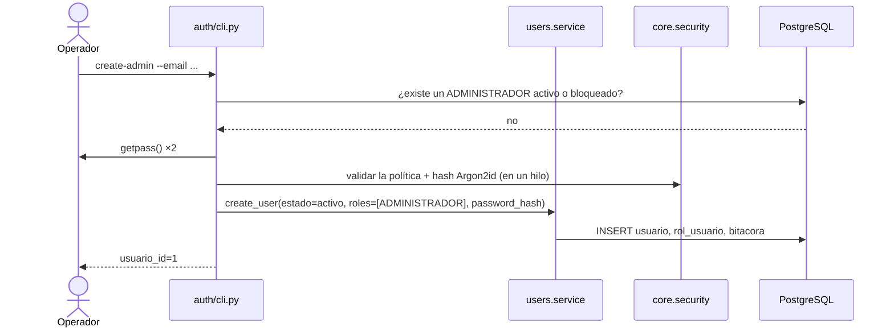
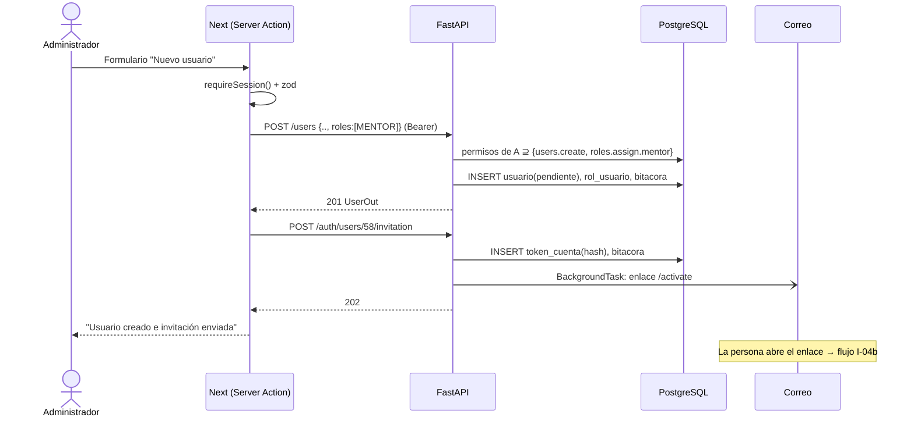
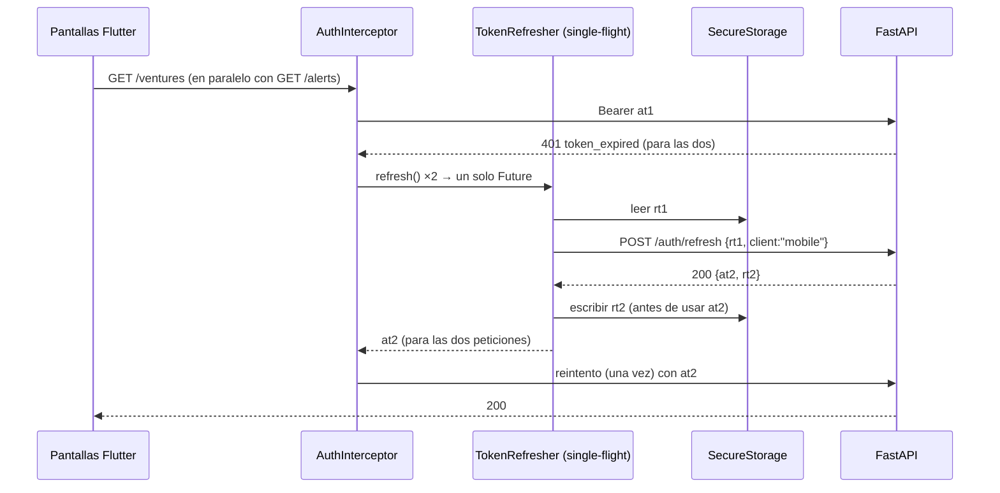
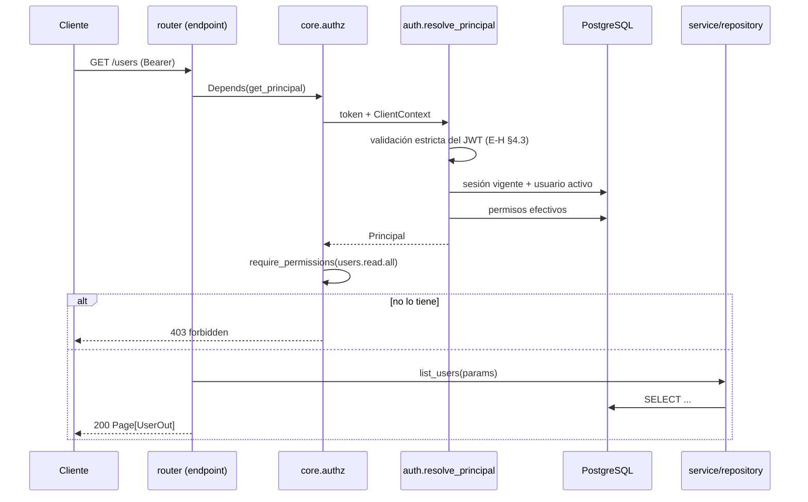
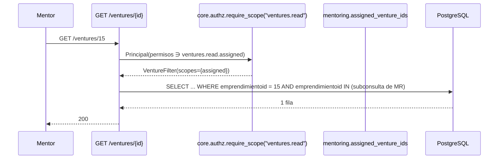

# F — Diagramas de secuencia · I — Flujos completos

Formato de cada flujo: **Actor · Precondiciones · Entradas · Validaciones ·
Persistencia · Endpoint · Respuesta · Errores · Auditoría · Pruebas**. Los
identificadores de prueba remiten a la matriz de [M](L-M-aceptacion-pruebas.md).

---

## I-01 Crear el primer administrador

- **Actor:** operador con acceso a la terminal del servidor.
- **Precondiciones:** las migraciones están aplicadas (incluida la siembra de roles); no
  existe ningún usuario con el rol `ADMINISTRADOR` en estado `activo` o `bloqueado`.
- **Entradas:** `--email`, `--nombre`, `--apellido` por argumento; la contraseña por
  `getpass`, dos veces.
- **Validaciones:** el formato del correo; que no exista; la política de contraseñas
  (B §5.2); que exista el rol `ADMINISTRADOR`; que no haya otro administrador (salvo
  con `--break-glass` y la confirmación del correo).
- **Persistencia:** en una transacción, `usuario` (con `estado = 'activo'` y
  `password_hash`) + `rol_usuario` + `bitacora`.
- **Endpoint:** ninguno (CLI `python -m emprendeu.modules.auth.cli create-admin`).
- **Respuesta:** `Administrador creado: usuario_id=1`, con código de salida 0.
- **Errores:** código 2 = ya existe un administrador; 3 = contraseña débil; 4 = correo
  repetido; 5 = sin siembra. Mensajes por `stderr`, **nunca** con la contraseña.
- **Auditoría:** `users.admin.bootstrap` (o `auth.admin.break_glass`), con `usuarioid = NULL`.
- **Pruebas:** T-BOOT-01…06.



## I-02 / I-03 Crear una cuenta de coordinador o de mentor

- **Actor:** un administrador. Para el mentor, también el coordinador si se aprueba N-05.
- **Precondiciones:** el actor está `activo` y tiene `users.create` + `roles.assign.coordinador`
  (o `.mentor`).
- **Entradas:** `nombre`, `apellido`, `email`, `telefono?`, `roles: ["COORDINADOR"]`.
- **Validaciones:** el esquema (G §0.5); que el correo no exista tras normalizarlo; un
  `roles.assign.*` por rol.
- **Persistencia:** `usuario` (`pendiente`, `password_hash NULL`) + `rol_usuario`;
  después `token_cuenta` (`invitacion`, 72 h).
- **Endpoint:** `POST /users` → `POST /auth/users/{id}/invitation`.
- **Respuesta:** `201 UserOut` y luego `202`.
- **Errores:** 403, 409 `email_taken`, 422.
- **Auditoría:** `users.created`, `users.role.assigned`, `auth.invitation.issued`.
- **Pruebas:** T-USR-01…08.



## I-04 Crear una cuenta de emprendedor

- **Actor:** un coordinador (o un administrador).
- **Precondiciones:** `users.create` + `roles.assign.emprendedor`. Para el perfil, también
  `entrepreneurs.create`.
- **Entradas:** los datos de la cuenta + `documento_identidad?`.
- **Validaciones:** las de I-02 y, en el perfil, que el usuario no tenga ya un `emprendedor`.
- **Persistencia:** `usuario(pendiente)` + `rol_usuario(EMPRENDEDOR)` + `emprendedor(estado='activo')`
  en **una** transacción (`POST /entrepreneurs` orquesta, B §6.1), y luego `token_cuenta`.
- **Endpoint:** `POST /entrepreneurs` (fase de `entrepreneurs`, N-17) **o**, mientras no
  exista, `POST /users` con el rol `EMPRENDEDOR` y el perfil en un paso posterior.
  Después, `POST /auth/users/{id}/invitation`.
- **Respuesta / errores / auditoría:** como en I-02, más `entrepreneurs.created` (en su fase).
- **Pruebas:** T-USR-09…12.

### I-04b Aceptar la invitación (cualquier rol)

- **Actor:** la persona invitada (anónima).
- **Precondiciones:** un token vigente; la cuenta en `pendiente`.
- **Entradas:** el `token` (leído del *fragment* `#token=` por un componente cliente),
  `password` y su confirmación (esta solo en la UI).
- **Validaciones:** el hash del token existe, `fecha_uso`/`fecha_invalidacion` son NULL,
  no ha caducado, `proposito = invitacion`, la cuenta está `pendiente`; y la política de
  contraseñas.
- **Persistencia:** `password_hash`, `estado = activo`, `fecha_actualizacion`;
  `token_cuenta.fecha_uso`; se invalidan las demás invitaciones.
- **Endpoint:** `POST /auth/invitations/accept`. **Respuesta:** 204 → la UI lleva a `/login`.
- **Errores:** 400 `invalid_or_expired_token`, 422 `weak_password`, 429.
- **Auditoría:** `auth.invitation.accepted`. **Pruebas:** T-PWD-10…14.

## I-05 Iniciar sesión

- **Actor:** cualquier persona con una cuenta.
- **Precondiciones:** ninguna.
- **Entradas:** `email`, `password`, `client`, `device_name?`.
- **Validaciones:** el límite (5 fallos por cuenta y 20 por IP en 15 min); Argon2id;
  estado `activo`.
- **Persistencia:** `intento_login`; `sesion_usuario`; `token_refresco`; rehash si hace
  falta; `bitacora`.
- **Endpoint:** `POST /auth/login`. **Respuesta:** `200 TokenPair + session + user + permisos`.
- **Errores:** 401 `invalid_credentials`, 403 `account_disabled`, 429 `too_many_attempts`, 422.
- **Auditoría:** `auth.login.succeeded` / `.failed` / `.throttled` / `.null_password`.
- **Pruebas:** T-AUTH-01…12.

```mermaid
sequenceDiagram
  actor U as Usuario
  participant B as Navegador
  participant N as Next (Server Action login)
  participant API as POST /auth/login
  participant DB as PostgreSQL
  U->>B: correo + contraseña
  B->>N: POST (Server Action; Next valida Origin == Host)
  N->>API: {email, password, client:"web"} + X-Forwarded-For
  API->>DB: COUNT intento_login (email_hmac, ip, 15 min)
  alt supera el límite
    API-->>N: 429 + Retry-After
  else
    API->>DB: SELECT usuario WHERE lower(email)=...
    API->>API: Argon2 verify (o hash ficticio) en un hilo
    alt incorrecta
      API->>DB: INSERT intento_login(exitoso=false) [transacción propia]
      API-->>N: 401 invalid_credentials
    else correcta pero no activa
      API-->>N: 403 account_disabled
    else correcta y activa
      API->>DB: INSERT sesion_usuario, token_refresco, intento_login(true), bitacora
      API-->>N: 200 TokenPair + me
      N->>B: Set-Cookie __Host-eu_at, __Host-eu_rt (HttpOnly) + redirect /
    end
  end
```

## I-06 Consultar la sesión

- **Actor:** un usuario autenticado. **Precondiciones:** un access token válido.
- **Validaciones:** E-H §4.3 + §3.5. **Persistencia:** ninguna.
- **Endpoint:** `GET /auth/me` (y `GET /auth/sessions` para ver todas).
- **Respuesta:** `MeOut`. **Errores:** 401 `not_authenticated` / `invalid_token` /
  `token_expired` / `session_revoked`. **Auditoría:** no. **Pruebas:** T-SES-11…14.

## I-07 Renovar la sesión

- **Actor:** el cliente (el `proxy.ts` web o el interceptor móvil).
- **Precondiciones:** un refresh token vigente.
- **Validaciones / persistencia:** E-H §3.2–§3.3.
- **Endpoint:** `POST /auth/refresh`. **Respuesta:** `200 TokenPair`.
- **Errores:** 401 `invalid_refresh_token`, 409 `refresh_superseded`.
- **Auditoría:** solo si se detecta reutilización. **Pruebas:** T-SES-01…10.

```mermaid
sequenceDiagram
  participant B as Navegador
  participant P as proxy.ts
  participant API as POST /auth/refresh
  participant DB as PostgreSQL
  B->>P: GET /ventures (cookie at caducado, rt)
  P->>API: {refresh_token: rt1, client:"web"}
  API->>DB: SELECT token_refresco WHERE hash=sha256(rt1) FOR UPDATE
  alt vigente
    API->>DB: UPDATE rt1.fecha_uso; INSERT rt2; UPDATE sesion.ultimo_uso
    API-->>P: 200 {at2, rt2}
    P->>B: Set-Cookie at2, rt2 + reescribe la cabecera Cookie del request
    P->>P: continúa el render con at2
  else usado hace ≤ 10 s (otra pestaña)
    API-->>P: 409 refresh_superseded
    P-->>B: 307 a la misma URL (el navegador ya tiene at2/rt2)
  else usado hace > 10 s (reutilización)
    API->>DB: UPDATE sesion SET revocada (reutilizacion_detectada); INSERT bitacora
    API-->>P: 401 invalid_refresh_token
    P-->>B: borrar cookies + 307 /session-expired
  end
```



## I-08 Cerrar la sesión

- **Actor:** un usuario autenticado. **Entradas:** `refresh_token` (lo pone el BFF a partir de la cookie, o lo lee el móvil del storage).
- **Persistencia:** `sesion_usuario.fecha_revocacion` y `motivo = logout`.
- **Endpoint:** `POST /auth/logout`. **Respuesta:** 204 siempre.
- **Efecto en el cliente:** la web borra las dos cookies (`Max-Age=0`) y redirige a
  `/login`; el móvil borra el storage y la memoria.
- **Auditoría:** `auth.logout`. **Pruebas:** T-SES-15…17.

## I-09 Cerrar todas las sesiones

- **Actor:** un usuario autenticado. **Persistencia:** UPDATE de todas sus sesiones
  vigentes (`logout_global`).
- **Endpoint:** `POST /auth/logout-all` → 204. Después, los demás dispositivos reciben
  `401 session_revoked` en su siguiente request.
- **Auditoría:** `auth.logout_all`. **Pruebas:** T-SES-18…19.

## I-10 Cambiar la contraseña

- **Actor:** un usuario autenticado.
- **Entradas:** `current_password`, `new_password`.
- **Validaciones:** el límite (5 fallos en 15 min); Argon2 de la actual; la política;
  que sea distinta de la actual.
- **Persistencia:** `password_hash`, `fecha_actualizacion`; revocar **las demás**
  sesiones (`cambio_contrasena`); invalidar los `token_cuenta` de restablecimiento pendientes.
- **Endpoint:** `POST /auth/change-password` → 204.
- **Errores:** 400 `invalid_current_password`, 422 `weak_password`, 429.
- **Auditoría:** `auth.password.changed`. **Notificación:** un correo de aviso.
  **Pruebas:** T-PWD-01…06.

## I-11 Recuperar la contraseña

- **Actor:** una persona anónima.
- **Entradas:** paso 1 `email`; paso 2 `token` + `new_password`.
- **Validaciones:** paso 1 el formato y el límite (3 por cuenta y 10 por IP cada hora);
  paso 2 como en I-04b, con `proposito = restablecimiento` y la cuenta `activo`.
- **Persistencia:** paso 1 `token_cuenta` (30 min), invalidando los anteriores; paso 2
  `password_hash`, `fecha_uso`, revocar **todas** las sesiones (`restablecimiento`).
- **Endpoints:** `POST /auth/password/forgot` (siempre 202) → `POST /auth/password/reset` (204).
- **Errores:** 400 `invalid_or_expired_token`, 422, 429 (solo en el paso 2: en el paso 1, un
  429 revelaría información, así que se devuelve 202 aunque no se envíe nada).
- **Auditoría:** `auth.password.reset_requested`, `auth.password.reset_completed`.
- **Pruebas:** T-PWD-07…09, T-PWD-15…20.

```mermaid
sequenceDiagram
  actor U as Persona
  participant N as Next
  participant API as FastAPI
  participant DB as PostgreSQL
  participant MAIL as Correo
  U->>N: /forgot-password (correo)
  N->>API: POST /auth/password/forgot
  API-->>N: 202 (siempre igual)
  API-)DB: BackgroundTask: ¿existe y está activo? ¿cabe en el límite?
  API-)DB: INSERT token_cuenta(hash), invalida los anteriores
  API-)MAIL: https://app/reset-password#token=euat_...
  U->>N: abre el enlace (el fragment no llega al servidor ni al Referer)
  N->>N: un componente cliente lee el #token y lo envía a una Server Action
  N->>API: POST /auth/password/reset {token, new_password}
  API->>DB: valida el token FOR UPDATE; UPDATE usuario; consume el token; revoca todas las sesiones
  API-->>N: 204
  N-->>U: "Contraseña actualizada. Inicia sesión."
```

## I-12 Bloquear o desactivar una cuenta

- **Actor:** un administrador (bloquear o desactivar) o un coordinador (desactivar
  emprendedores, por dominancia).
- **Precondiciones:** el permiso de la transición; la dominancia; no es uno mismo; la
  transición es válida.
- **Entradas:** `estado` y `motivo`.
- **Validaciones:** B §2.2, B §7.1 (último administrador, con `FOR UPDATE`).
- **Persistencia:** `usuario.estado`, `fecha_actualizacion`; se invalidan los `token_cuenta`
  pendientes; las sesiones mueren de inmediato, porque el `Principal` exige `activo`, y se
  marcan revocadas al detectarlo (E-H §3.4).
- **Endpoint:** `POST /users/{id}/status` → `200 UserOut`.
- **Errores:** 403, 404, 409 `invalid_status_transition` / `last_admin`.
- **Auditoría:** `users.status.changed`. **Pruebas:** T-ADM-01…08.

## I-13 Rehabilitar una cuenta

- Igual que I-12, con `users.status.unblock` (bloqueado → activo) o
  `users.status.reactivate` (inactivo → activo o pendiente).
- Si queda `pendiente` (no tiene contraseña), la UI ofrece "Enviar invitación".
- Las sesiones antiguas **no** reviven: ya estaban revocadas o se revocan al
  reactivar. Se revocan explícitamente todas las de la cuenta al rehabilitarla.
- **Pruebas:** T-ADM-09…12.

## I-14 Asignar un rol

- **Actor:** quien tenga `roles.assign.<rol>`.
- **Validaciones:** el rol existe; no es uno mismo; dominancia sobre los roles actuales del destino.
- **Persistencia:** `INSERT rol_usuario` (idempotente por `uq_rol_usuario_rolid_usuarioid`).
- **Endpoint:** `POST /users/{id}/roles` → 201 / 200.
- **Efecto:** los permisos nuevos valen en el siguiente request del usuario.
- **Auditoría:** `users.role.assigned`. **Pruebas:** T-ADM-13…16.

## I-15 Revocar un rol

- Como en I-14, más las reglas `last_admin` y `last_role`.
- **Persistencia:** `DELETE rol_usuario` (con `FOR UPDATE` sobre la fila del rol
  `ADMINISTRADOR` si es ese el rol revocado).
- **Endpoint:** `DELETE /users/{id}/roles/{rol}` → 204.
- **Efecto:** los permisos se pierden en el siguiente request; no hace falta revocar sesiones.
- **Auditoría:** `users.role.revoked`. **Pruebas:** T-ADM-17…19.

## I-16 Consultar un recurso protegido (genérico)



**Pruebas:** T-AZ-01…08.

## I-17 Un mentor consulta un emprendimiento asignado

- **Precondiciones:** el mentor está `activo`; tiene `ventures.read.assigned`; existe
  una fila de `asignaciones` con `estado='activa'`, `fecha_inicio <= now()` y
  `fecha_fin` NULL o futura.
- **Endpoint previsto:** `GET /ventures/{id}` (en la fase de `ventures`). En esta fase
  se prueba con un **endpoint de prueba** registrado solo en los tests (K §1.6).
- **Resultado:** 200. **Pruebas:** T-AZ-10…14.



## I-18 Un mentor consulta un emprendimiento ajeno

- La misma consulta devuelve 0 filas → **404 `not_found`**, con el cuerpo idéntico al de un id inexistente.
- Casos cubiertos: sin asignación; asignación `finalizada`/`suspendida`; `fecha_inicio`
  futura o NULL; `fecha_fin` pasada; asignación de **otro** mentor; estado con
  mayúsculas o espacios (`' Activa '`, que sí cuenta como vigente, por la
  normalización).
- **Pruebas:** T-AZ-15…22.

## I-19 Un emprendedor consulta su emprendimiento

- **Precondiciones:** cuenta `activo`; `ventures.read.own`; `emprendedor.estado='activo'`;
  una fila en `emprendimiento_emprendedores` con `fecha_ingreso <= now()` (y sin
  `fecha_salida` pasada, si se aprueba la migración).
- **Resultado:** 200. **Pruebas:** T-AZ-23…26.

## I-20 Un emprendedor consulta un emprendimiento ajeno

- **404 `not_found`**. También si su perfil `emprendedor` está `inactivo`, si
  `fecha_ingreso` es NULL o futura, o si el emprendimiento existe pero no es suyo.
- Un usuario con los roles `EMPRENDEDOR` + `MENTOR` ve la **unión** de sus asignados y sus
  propios, y nada más.
- **Pruebas:** T-AZ-27…32.
