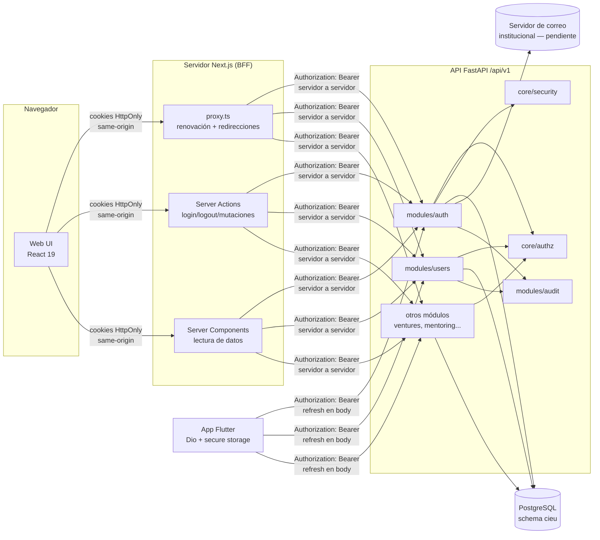

# Fase 01 — Especificación de identidad, sesiones y autorización

> Documento de **diseño**. Esta fase no modifica código. Todo lo que aquí se
> describe como archivo, tabla o endpoint es la forma que **debe** tomar la
> implementación en las fases siguientes, una vez aprobado.
>
> Fecha de verificación del repositorio: **2026-10-20**, commit `1209ffa`
> (rama `feature/creacion_flutter_definicion_arquitectura`).

## Leyenda de clasificación

Cada hallazgo o regla va etiquetado:

| Etiqueta | Significado |
|---|---|
| **[C] Confirmado** | Verificado leyendo el código, el ORM, el SQL o las dependencias instaladas. |
| **[P] Propuesto** | Decisión técnica de este diseño. Se aplica si se aprueba la fase. |
| **[D] Pendiente CIE-U** | Regla institucional que el equipo técnico **no** puede inventar. El diseño trae un valor por defecto seguro, configurable, hasta que el CIE-U decida. Catálogo en [N](N-decisiones-pendientes.md). |

## Índice de entregables

| # | Entregable | Archivo |
|---|---|---|
| A | Documento de arquitectura | este archivo, §2–§5 |
| B | Modelo de identidad | [B-modelo-identidad.md](B-modelo-identidad.md) |
| C | Matriz completa RBAC | [C-D-autorizacion.md](C-D-autorizacion.md) §1–§4 |
| D | Políticas de autorización por recurso | [C-D-autorizacion.md](C-D-autorizacion.md) §5–§11 |
| E | Diagrama entidad-relación | [E-H-datos-sesiones-tokens.md](E-H-datos-sesiones-tokens.md) §1 |
| F | Diagramas de secuencia | [F-I-flujos.md](F-I-flujos.md) (junto a cada flujo) |
| G | Contratos API | [G-contratos-api.md](G-contratos-api.md) |
| H | Modelo de sesiones (+ JWT y transporte) | [E-H-datos-sesiones-tokens.md](E-H-datos-sesiones-tokens.md) §2–§6 |
| I | Flujos completos | [F-I-flujos.md](F-I-flujos.md) |
| J | Diseño funcional de pantallas | [J-pantallas-web.md](J-pantallas-web.md) |
| K | Estructura de archivos | [K-estructura-archivos.md](K-estructura-archivos.md) |
| L | Criterios de aceptación | [L-M-aceptacion-pruebas.md](L-M-aceptacion-pruebas.md) §1 |
| M | Matriz de pruebas | [L-M-aceptacion-pruebas.md](L-M-aceptacion-pruebas.md) §2 |
| N | Decisiones institucionales pendientes | [N-decisiones-pendientes.md](N-decisiones-pendientes.md) |

---

## 1. Estado verificado del repositorio

### 1.1 Confirmado

- **[C]** Backend: FastAPI con una sola app (`emprendeu.main:create_app`), `core/config.py`,
  `core/errors.py` (`DomainError`, `NotFoundError`, `ConflictError` y el formato
  `{"error": {"code", "message", "details"}}`), `db/session.py` (una `AsyncSession`
  por request), `api/v1.py` vacío (sin routers). No existen `router.py`, `service.py`,
  `repository.py` ni `schemas.py` en ningún módulo.
- **[C]** Dependencias bloqueadas en `uv.lock`: `pyjwt 2.15.1`, `pwdlib 0.3.1`,
  `argon2-cffi 25.1.0`. **`cryptography` no está instalado**, y PyJWT lo necesita
  para ES256/EdDSA/RS256. Los valores por defecto de Argon2 instalados, medidos
  con `argon2.PasswordHasher()`, son Argon2id, `t=3`, `m=65536 KiB` y `p=4`.
- **[C]** No hay módulo `auth` en `modules/`. Los 11 módulos son `users`, `entrepreneurs`, `ventures`,
  `mentoring`, `training`, `gamification`, `ai_assistant`, `indicators`, `alerts`,
  `documents` y `audit`.
- **[C]** Web: Next.js 16.3.8, React 19.2.8, `zustand` 5, `@base-ui/react`, shadcn 4.
  Solo la plantilla. En Next 16 el middleware se llama `proxy.ts` (`node_modules/next/dist/docs/01-app/03-api-reference/03-file-conventions/proxy.md`).
  `forbidden()`/`unauthorized()` son **experimentales** y requieren `authInterrupts`.
  Las Server Actions comparan `Origin` con `Host` (docs `02-guides/data-security.md`).
- **[C]** Móvil: `pubspec.yaml` declara `flutter_riverpod ^3.4.3`, `go_router ^18.1.0`,
  `dio ^5.11.1` y `flutter_secure_storage ^11.2.0`. **El `AGENTS.md` del móvil dice que los
  paquetes "siguen pendientes": está desactualizado** respecto al `pubspec.yaml`.
- **[C]** Hay un worktree ajeno, `.claude/worktrees/auth-module`, con cambios **sin commitear** en
  `core/` (`security.py`, `middleware.py`, `transactions.py`, `pagination.py`,
  `logging.py`, `config.py` y `errors.py`). Ese trabajo coloca las cookies y el CSRF en el **backend**
  (`cookie_domain`, `csrf_cookie_name`). Este diseño propone otra cosa (§3.3). Ver riesgo R-01.

### 1.2 Hallazgos del esquema que condicionan el diseño

| # | Hallazgo | Clase | Consecuencia de diseño |
|---|---|---|---|
| H-01 | `usuario.estado VARCHAR(40) NULL`, sin CHECK ni vocabulario. | [C] | Vocabulario canónico en minúsculas + CHECK por migración incremental (B §2). Mientras tanto, un valor desconocido o NULL se trata como **no activo**: falla cerrado. |
| H-02 | `usuario.password_hash VARCHAR(255) NULL`. | [C] | NULL significa "sin credencial local". Nunca permite iniciar sesión (B §5). |
| H-03 | `uq_usuario_email` distingue mayúsculas: `Ana@x` y `ana@x` serían dos cuentas. | [C] | Normalizar en la aplicación y añadir un índice único sobre `lower(email)` (B §3). |
| H-04 | `permiso` solo tiene `permisoid` y `nombre VARCHAR(160)`. No tiene recurso, acción ni descripción. | [C] | El **código estable** del permiso se guarda en `permiso.nombre`. Se propone añadir `permiso.descripcion TEXT NULL` (C §1). |
| H-05 | `rol_usuario` no tiene fecha, autor ni estado. | [C] | Revocar es `DELETE` de la fila. El historial queda en `bitacora` (B §8). |
| H-06 | `asignaciones` apunta a `usuario`, no hay tabla `mentor`; `estado` y `tipo_asignacion` son texto libre; puede haber varias filas para el mismo par. | [C] | Mentor = usuario con rol `MENTOR` + asignación vigente. Vigencia normalizada (C-D §7). |
| H-07 | `emprendimiento_emprendedores` **no tiene `estado` ni fecha de salida**; solo `fecha_ingreso` y `rol_en_emprendimiento`. | [C] | No hay forma de terminar una membresía sin borrar la fila. Se propone `fecha_salida` (E-H §1.3). Pendiente de aprobación porque toca el módulo `entrepreneurs`. |
| H-08 | `emprendedor.documento_identidad` no es único; `emprendedor.usuarioid` sí lo es. | [C] | Un usuario, como mucho un perfil de emprendedor. La unicidad del documento es una decisión del CIE-U (N-07). |
| H-09 | `bitacora.fecha` no tiene DEFAULT; `usuarioid` es NULL-able y tiene `FK ... ON DELETE RESTRICT`. | [C] | El servicio de auditoría fija `fecha` explícitamente. Un usuario auditado **no puede borrarse**, lo que es coherente con "nunca hard delete" (B §8). |
| H-10 | El único precedente de vocabulario de estado es `lower(estado) = 'activa'` (índice `uq_emprendimiento_etapa_activa`). | [C] | Convención: estados en **minúsculas, en español**, comparados con `lower(btrim(...))`. |
| H-11 | `core/errors.DomainError` no admite cabeceras (`WWW-Authenticate`, `Retry-After`). | [C] | Ampliar `DomainError` con `headers` opcionales (K §1). |
| H-12 | El `StarletteHTTPException` de las dependencias de seguridad de FastAPI saldría como `code: "http_error"`. | [C] | No usar `HTTPBearer(auto_error=True)`. Los errores de auth son `DomainError` con código propio (G §0.3). |

---

## 2. A — Arquitectura

### 2.1 Vista de contexto

### 2.2 Principios

1. **[P] Un único contrato de credenciales en el backend: Bearer + refresh opaco en el body.**
   El backend no emite ni lee cookies. Esto elimina el CSRF del lado de la API y
   hace que web y móvil consuman exactamente los mismos endpoints (regla global §5).
2. **[P] El navegador nunca habla con FastAPI.** Next.js actúa como BFF: guarda los
   tokens en cookies `HttpOnly` de su propio origen y los reenvía como `Bearer`.
   El backend no necesita CORS.
3. **[P] La autorización se decide siempre en el backend y con datos frescos.**
   El JWT solo identifica (`sub`, `sid`). Roles, permisos, estado de la cuenta y
   asignaciones se leen de la base **en cada request protegido**. Revocar un rol,
   desactivar una cuenta o cerrar una sesión surte efecto en el siguiente request,
   sin esperar a que caduque el access token.
4. **[P] Permisos granulares con alcance**, no comparaciones de nombre de rol:
   `ventures.read.all | .assigned | .own`. El rol es solo un agrupador de permisos
   en `rol_permiso`. La **única fuente de verdad** de qué rol tiene qué permiso es la
   base de datos, sembrada por una migración versionada (C §2).
5. **[P] Falla cerrado.** Estado desconocido o NULL, fecha de inicio NULL, token sin
   un claim obligatorio o `kid` desconocido: todo eso se deniega.
6. **[P] No filtrar existencia.** Un recurso de un emprendimiento al que el actor no
   tiene alcance responde **404**, igual que uno inexistente (C-D §9).

### 2.3 Responsabilidades por módulo (monolito modular)

| Pieza | Responsabilidad | Depende de | Clase |
|---|---|---|---|
| `core/security.py` | Argon2id (pwdlib) en hilo aparte; firma y verificación de JWT (PyJWT); generación y hash de tokens opacos; comparación en tiempo constante. **Sin acceso a BD.** | — | [P] |
| `core/authz.py` | Tipo `Principal`; dependencias FastAPI `CurrentPrincipal`, `require_permissions(...)`, `authorize_venture(...)`; **registro** de resolvedores (inversión de dependencias: `core` no importa `modules`). | `core/errors` | [P] |
| `modules/auth` | Login, refresh con rotación, logout, sesiones, cambio y recuperación de contraseña, invitaciones, rate limit de login, CLI de primer administrador. Resuelve el `Principal` desde un JWT. | `users`, `audit` (servicios) | [P] |
| `modules/users` | CRUD administrativo de `usuario`, roles del usuario, catálogo de roles/permisos de solo lectura, regla de **dominancia** (quién puede gestionar a quién), permisos efectivos. | `audit` | [P] |
| `modules/audit` | Escritura de `bitacora` (servicio) y su consulta (`GET /audit/events`). | — | [P] |
| `modules/mentoring` | Resolver de alcance `assigned` (asignación vigente). **Solo el resolver** en la fase de implementación de identidad; el CRUD de asignaciones va en su propia fase. | — | [P] |
| `modules/entrepreneurs` | Resolver de alcance `own` (membresía vigente). | — | [P] |
| `api/v1.py` | Agrega routers **y** cablea los resolvedores en `core/authz` (`configure_authorization`). Es el único agregador permitido, junto a `db/metadata.py`. | todos | [P] |

**Dirección de dependencias entre módulos [P]:** `auth → users → audit`, y `auth → audit`.
`users` **no** depende de `auth`, para evitar el ciclo. Las consecuencias en la
seguridad de la sesión (p. ej., desactivar una cuenta) se garantizan porque
`auth` comprueba `usuario.estado` en cada request y en cada refresh (§2.2.3), sin
que `users` tenga que llamar a `auth`.

### 2.4 Por qué se mantiene el patrón de AGENTS.md

No se introduce Clean Architecture. Cada módulo sigue con `router → service →
repository → models`. Solo se añaden tres piezas, con una responsabilidad real
cada una:

- `core/authz.py`: lo pide la directiva maestra.
- `modules/<m>/policies.py` en `users`: la regla de dominancia es una política
  reutilizable que no es ni query ni orquestación.
- `modules/auth/cli.py`: el aprovisionamiento del primer administrador no puede
  pasar por HTTP (B §4.1).

Los tres hay que añadirlos a la estructura del `Backend/EmprendeU/AGENTS.md` en el
mismo commit en que se creen (regla global §4.4).

---

## 3. Decisiones clave (resumen)

| # | Decisión | Alternativa descartada | Motivo | Clase |
|---|---|---|---|---|
| DA-01 | Access token JWT **HS256** con `kid`, 15 min. | ES256/EdDSA | Un único emisor y verificador (el backend); evita añadir `cryptography`. Se reevalúa si otro servicio debe verificar (N-15). | [P] |
| DA-02 | Refresh token **opaco** (256 bits), solo su SHA-256 en BD, rotado en cada uso. | Refresh como JWT | Revocable por definición; no se puede confundir con un access token; no se puede verificar sin BD. | [P] |
| DA-03 | Tablas nuevas `sesion_usuario` + `token_refresco` (historial). | Una sola tabla con el hash actual | El historial permite detectar la **reutilización** de un token ya consumido sin abrir un DoS por `sid` (E-H §3.4). | [P] |
| DA-04 | El backend solo acepta Bearer; las cookies son del BFF de Next. | Cookies emitidas por FastAPI (enfoque del worktree `auth-module`) | Un solo contrato; el backend no necesita CSRF ni CORS; los tokens del navegador nunca salen del servidor Next. | [P] |
| DA-05 | Permisos con sufijo de alcance `.all/.assigned/.own`. | `if role == "MENTOR"` | Granularidad, configuración desde la BD (p. ej., el alcance del coordinador, C-D §5) y múltiples roles sin código especial. | [P] |
| DA-06 | El rol se asigna con el permiso `roles.assign.<rol>` y además la regla de dominancia. | Un permiso genérico `roles.assign` | Impide la escalada: el coordinador solo puede otorgar `EMPRENDEDOR`. | [P] |
| DA-07 | 404 para recursos sin alcance; 403 para la ausencia total del permiso. | 403 siempre | No revela la existencia de emprendimientos ajenos. | [P] |
| DA-08 | El administrador **no** recibe permisos de negocio (`*.all` de ventures, mentoring...). | Administrador omnipotente | Separa la administración técnica del acceso a información empresarial sensible (N-04). | [P] / [D] |
| DA-09 | Sin registro público. Las altas son aprovisionadas, con invitación de un solo uso. | Registro abierto | Requisito de la directiva; el autorregistro con dominio institucional queda en N-01. | [P] / [D] |

## 4. Riesgos y pendientes de la fase

| # | Riesgo | Mitigación |
|---|---|---|
| R-01 | El worktree `auth-module` tiene `core/` sin commitear con supuestos distintos (cookies en el backend, un único `jwt_secret_key` sin `kid`). | Decidir antes de implementar: o se adapta a este diseño, o este diseño se ajusta. No mezclar las dos cosas. |
| R-02 | No hay infraestructura de correo. Los flujos 4 y 11 dependen de ella. | `MAIL_BACKEND` intercambiable (`smtp`/`file`/`memory`). `file` está prohibido en producción. Alternativa: el enlace de activación entregado por el administrador (N-10). |
| R-03 | La topología de despliegue es desconocida (¿proxy inverso?, ¿mismo host?). El backend vería la IP del BFF. | `TRUSTED_PROXIES` explícito. Sin configurarlo, el límite por IP se desactiva y se avisa al arrancar (E-H §7). |
| R-04 | `forbidden()` de Next es experimental. | Usarlo tras el flag `authInterrupts`, con *fallback* documentado (J §5). Decisión en N-16. |
| R-05 | Cambiar la nulabilidad o añadir un CHECK a `usuario.estado` y un índice sobre `lower(email)` altera tablas de la baseline. | Solo por migración incremental, nunca editando la baseline; verificado con `alembic check` y `pg_dump` (AGENTS backend §5.12). |
| R-06 | Una consulta a BD por request para validar la sesión y otra para los permisos. | Aceptable para el volumen previsto. Índices dedicados. Medir antes de cachear; cualquier caché debe invalidarse al revocar. |
