

Centro de Innovación y Emprendimiento Universitario (CIE-U)

EmprendeU

Plataforma universitaria de emprendimiento

MANUAL DE USUARIO

Panel web del personal del CIE-U y aplicación móvil del emprendedor

Versión 1.0

Equipo responsable: Equipo de desarrollo de EmprendeU (por confirmar)

18 de noviembre de 2026

\pagebreak

#* ÍNDICE GENERAL

[[TOC]]

\pagebreak

#* ÍNDICE DE FIGURAS

[[LOF]]

\pagebreak

#* ÍNDICE DE TABLAS

[[LOT]]

# CAPÍTULO 1. INTRODUCCIÓN

## 1.1. Presentación del sistema

EmprendeU es la plataforma universitaria de emprendimiento del Centro de Innovación y Emprendimiento Universitario (CIE-U). Reúne en un mismo sistema el acompañamiento a los emprendimientos de estudiantes: seguimiento de etapas, mentorías con asesores, retos con puntos de experiencia (XP), capacitaciones, alertas de riesgo y un coach de inteligencia artificial.

El sistema se compone de dos aplicaciones que comparten los mismos datos. El **panel web** lo utiliza el personal del CIE-U (administradores, coordinadores y asesores). La **aplicación móvil** la utilizan las personas emprendedoras.

## 1.2. Objetivo del manual

Este manual explica, paso a paso, cómo utilizar las funciones disponibles de EmprendeU, desde la perspectiva de la persona usuaria y sin requerir conocimientos de programación.

## 1.3. Alcance del documento

El manual documenta las funcionalidades implementadas y comprobadas en la versión analizada del sistema: el panel web (rutas públicas y rutas del personal) y la aplicación móvil del emprendedor. No describe funciones planificadas que no estén implementadas. Los aspectos que no pudieron comprobarse se indican como *pendientes de verificación* y se listan en el Anexo B.

## 1.4. Público al que está dirigido

- Personal administrador, coordinador y asesor del CIE-U, que usa el panel web.
- Estudiantes emprendedores, que usan la aplicación móvil y pueden postular desde la web pública.

## 1.5. Descripción general del sistema

Los emprendimientos avanzan por cuatro etapas: Preincubación, Incubación, Crecimiento y Graduación. En cada etapa, el emprendedor cumple retos que otorgan XP e insignias. Los asesores acompañan con mentorías, recomendaciones y compromisos. La coordinación supervisa la salud de cada emprendimiento mediante indicadores, alertas y reportes.

## 1.6. Organización del manual

El Capítulo 2 describe el sistema y sus roles. El Capítulo 3 explica el acceso. El Capítulo 4 presenta la interfaz. El Capítulo 5 detalla cada módulo. El Capítulo 6 reúne procedimientos completos. Los Capítulos 7 a 10 tratan los mensajes y la solución de problemas, las buenas prácticas, el glosario y las preguntas frecuentes.

# CAPÍTULO 2. INFORMACIÓN GENERAL DEL SISTEMA

## 2.1. Descripción del software

EmprendeU es una solución multiplataforma. El panel web funciona en un navegador actual. La aplicación móvil está desarrollada para Android e iOS; en la verificación de este manual se ejecutó en un teléfono Android.

## 2.2. Características principales

- Postulación pública de emprendimientos y admisión por parte del CIE-U.
- Registro de emprendedores y emprendimientos, con equipo y etapas.
- Mentorías: asignación de asesores, disponibilidad horaria y registro de sesiones.
- Retos, XP, niveles e insignias para el emprendedor.
- Alertas de riesgo, indicadores de salud y reportes exportables (CSV y Excel).
- Capacitaciones con inscripción y asistencia.
- Coach de IA para el emprendedor, que también funciona sin internet si se descarga la IA en el teléfono.
- Asistente de ayuda y tutorial guiado en el panel web.
- Notificaciones dentro de la aplicación móvil.

## 2.3. Requisitos para su utilización

- **Panel web:** navegador actual y una cuenta creada por el CIE-U con rol de personal.
- **Aplicación móvil:** teléfono con la aplicación instalada y una cuenta de emprendedor. Casi todas las funciones requieren conexión a internet.
- **IA sin conexión (opcional):** dispositivo Android compatible. Se descargan aproximadamente 2,6 GB y 165 MB, por lo que se recomienda usar Wi‑Fi y disponer del doble del tamaño libre.

## 2.4. Roles de usuario

Tabla: Roles del sistema

| Rol | Dónde trabaja | Descripción |
|---|---|---|
| Administrador | Panel web | Gestiona usuarios, roles, permisos, parámetros y catálogos. |
| Coordinador | Panel web | Supervisa emprendedores, emprendimientos, mentorías, alertas y reportes. |
| Asesor / Mentor | Panel web | Acompaña a los emprendimientos que tiene asignados. |
| Emprendedor | Aplicación móvil | Gestiona su emprendimiento, sus retos y sus mentorías. |

El panel web rechaza las cuentas de emprendedor con el mensaje «Esta cuenta es de emprendedor: usa la app móvil del CIE-U.». La aplicación móvil rechaza las cuentas del personal con «Esta cuenta es del panel web del CIE-U. Esta app es para emprendedores.». Un administrador puede crear roles personalizados y editar los permisos de cada rol, por lo que la tabla siguiente muestra la configuración inicial.

## 2.5. Funcionalidades disponibles por rol

Los permisos se agrupan en siete módulos y cuatro acciones: consulta (C), registro (R), modificación (M) y administrativo (A).

Tabla: Permisos iniciales por rol

| Módulo | Administrador | Coordinador | Asesor | Emprendedor |
|---|---|---|---|---|
| Usuarios y roles | C R M A | — | — | — |
| Emprendedores y emprendimientos | C | C R M | C | C R |
| Asesorías y mentorías | C | C R | C R M | C |
| Seguimiento y etapas | C | C R M | C R | C R |
| Asistente inteligente | — | C | — | C R |
| Indicadores y reportes | C | C R | — | — |
| Configuración del sistema | C R M A | C M | — | — |

El menú lateral muestra solo las pantallas permitidas por los permisos de la persona. Si una pantalla no está permitida, el sistema muestra «Sin acceso a …» con el texto «Tu rol no tiene permiso para ver esta sección. Si lo necesitas, pídeselo a un administrador.».

## 2.6. Recomendaciones generales de utilización

- Cierre la sesión al terminar, sobre todo en equipos compartidos.
- Cambie la contraseña temporal que recibió al crearse su cuenta.
- Revise los datos antes de confirmar acciones definitivas, como admitir o rechazar una postulación.

# CAPÍTULO 3. ACCESO AL SISTEMA

## 3.1. Ingreso a la aplicación

El panel web se abre desde el navegador, en la dirección que el CIE-U proporcione. La página de inicio ({{fig:web_landing}}) presenta el programa y ofrece los botones «Postula tu emprendimiento» y «Personal CIE-U». Si ya hay una sesión activa, aparece «Ir al panel».

## 3.2. Inicio de sesión

**Panel web.**

1. En la página de inicio, seleccionar «Personal CIE-U».
2. Escribir el «Correo electrónico».
3. Escribir la «Contraseña».
4. Seleccionar «Ingresar al panel».
5. El sistema abre la pantalla «Resumen».

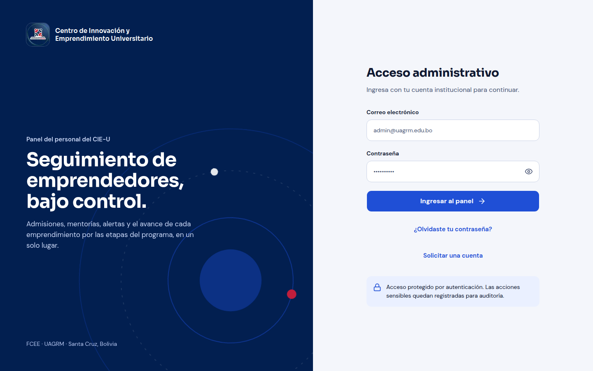

**Aplicación móvil.**

1. Abrir la aplicación EmprendeU.
2. Escribir el «Correo electrónico» y la «Contraseña». El ícono del ojo muestra u oculta la contraseña.
3. Tocar «Ingresar».
4. La aplicación abre la pantalla «Inicio».

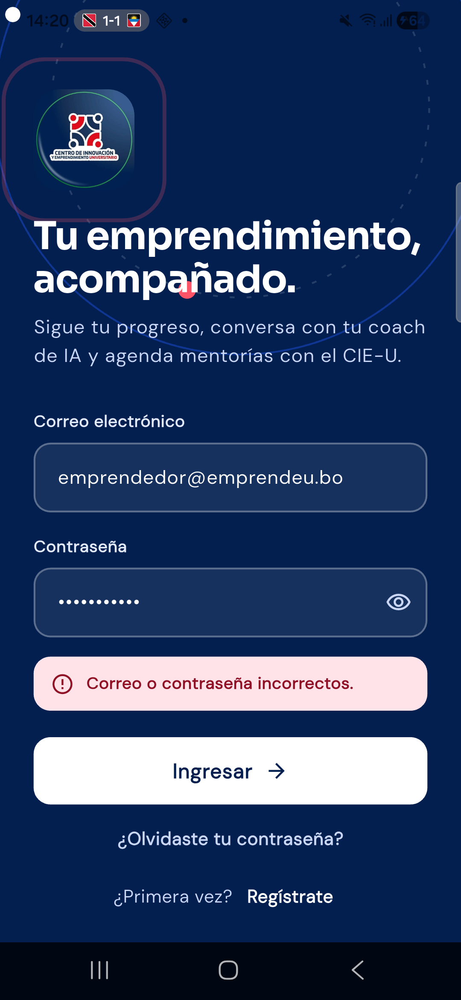

*Validaciones:* «Ingresa tu correo electrónico.», «Ingresa un correo válido.» e «Ingresa tu contraseña.». Tras varios intentos fallidos el sistema limita los intentos y pide esperar unos segundos. Si la cuenta está deshabilitada aparece «Tu cuenta está deshabilitada. Contacta al CIE-U.».

## 3.3. Registro y postulación

**Crear cuenta.** Desde «Solicitar acceso» en el inicio de sesión web, o «Regístrate» en la aplicación móvil, se completa «Nombre completo», «Correo electrónico», contraseña (mínimo 8 caracteres) y «Confirmar contraseña», y se selecciona «Crear cuenta». La cuenta creada es siempre de emprendedor; en el panel web no ingresa hasta que un administrador le asigne un rol de personal.

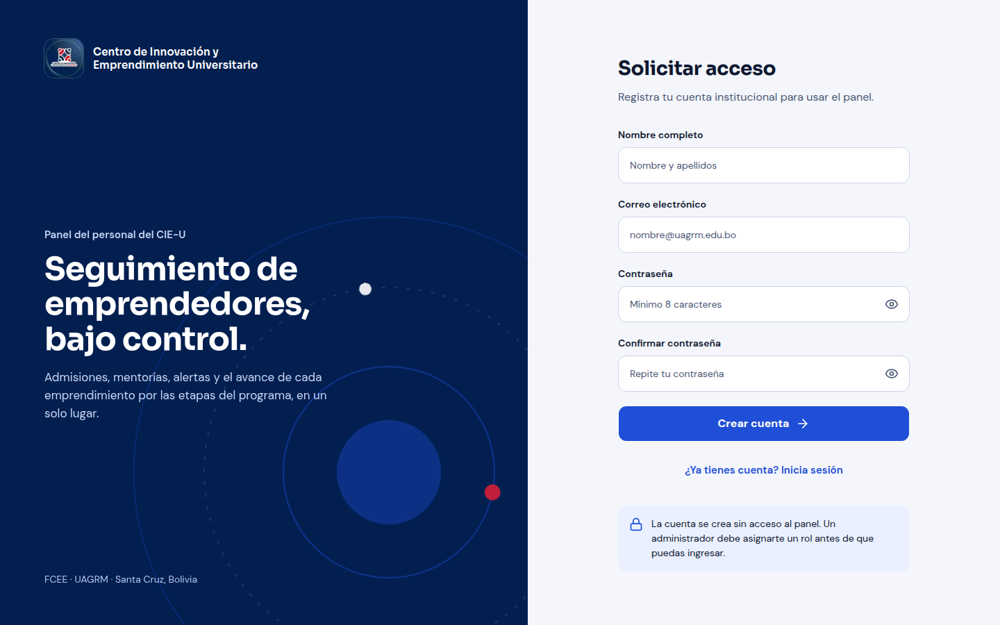

**Postular un emprendimiento.** La página pública «Postula tu emprendimiento» ({{fig:web_apply}}) no requiere cuenta.

1. Seleccionar «Postular» en la página de inicio.
2. Completar «Nombre», «Apellidos», «Correo electrónico», «Documento de identidad» y «Nombre de tu emprendimiento». Los campos «Sector», «Teléfono» y «Cuéntanos de tu idea» son opcionales.
3. Enviar el formulario.
4. El sistema confirma: «Recibimos tu postulación. El equipo del CIE-U la evaluará y se pondrá en contacto contigo.».

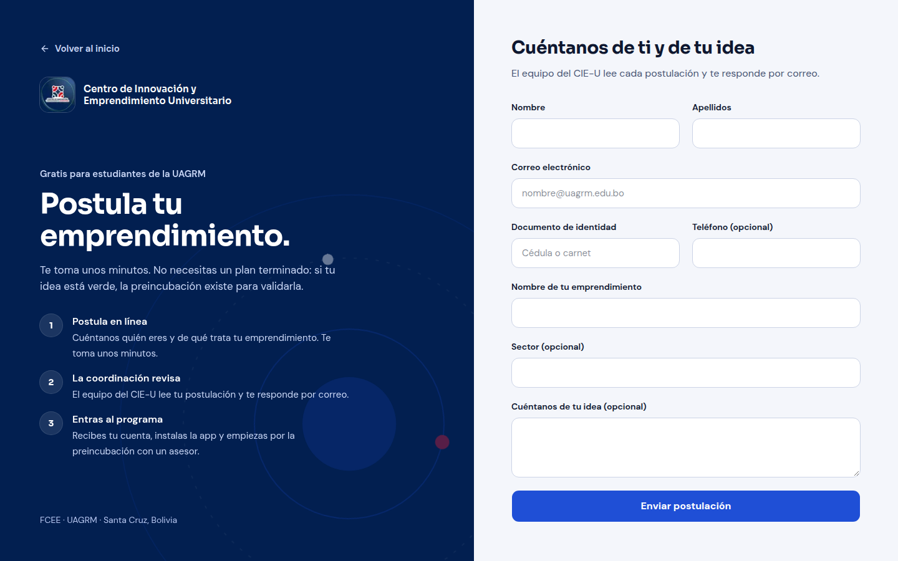

Si ya existe una postulación pendiente con el mismo correo aparece «Ya tenemos una postulación pendiente con ese correo.».

## 3.4. Recuperación de contraseña

1. Seleccionar «¿Olvidaste tu contraseña?» en la pantalla de ingreso.
2. Escribir el correo y seleccionar «Enviar código». El sistema envía un código de 6 dígitos que vence en 15 minutos. La respuesta es la misma exista o no la cuenta.
3. Escribir el «Código de 6 dígitos», la «Nueva contraseña» y su confirmación.
4. Seleccionar «Restablecer contraseña» (en la aplicación móvil, «Restablecer»).
5. El sistema redirige al ingreso con el aviso «Contraseña actualizada. Ya puedes iniciar sesión.».

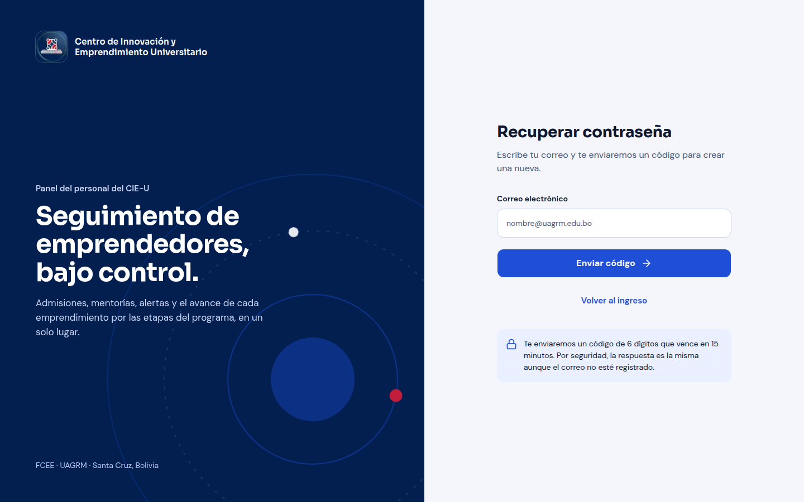

Si el código es incorrecto o venció: «El código no es válido o ya venció. Pide uno nuevo.». Si el servicio de correo no está disponible: «No pudimos enviar el correo. Intenta de nuevo en unos minutos.».

## 3.5. Descripción de la pantalla inicial

Tras ingresar, el personal ve «Resumen» ({{fig:web_admin_panel}}). La aplicación móvil abre «Inicio» ({{fig:movil_inicio}}).

## 3.6. Navegación entre las secciones

En el panel web, el menú lateral agrupa las pantallas en Inicio, Programa, Acompañamiento y Configuración. En pantallas pequeñas el menú se abre como una hoja lateral. En la aplicación móvil, la barra inferior tiene cinco pestañas: Inicio, Camino, Mentorías, Coach y Perfil.

## 3.7. Cierre de sesión

En el panel web, seleccionar «Cerrar sesión» al pie del menú lateral. En la aplicación móvil, abrir la pestaña «Perfil» y tocar «Cerrar sesión»; esta acción borra los datos locales de la sesión.

# CAPÍTULO 4. INTERFAZ GENERAL

## 4.1. Descripción de la interfaz

Ambas aplicaciones usan la identidad visual del CIE-U: fondo claro, azul marino para el menú y azul para los botones principales.

## 4.2. Menú principal

El menú lateral del panel web muestra solo las secciones permitidas. Al pie aparece la tarjeta de la persona con su rol y el acceso a «Mi cuenta». «Alertas» muestra una insignia con el número de alertas abiertas.

Tabla: Menú del panel web

| Grupo | Opciones |
|---|---|
| Inicio | Resumen, Indicadores, Reportes |
| Programa | Admisiones, Emprendedores, Emprendimientos, Necesidades, Alertas, Salud |
| Acompañamiento | Asignaciones, Mi disponibilidad, Sesiones, Capacitaciones |
| Configuración | Usuarios, Roles y permisos, Parámetros, Catálogos y XP, Base de conocimiento, Auditoría |

## 4.3. Barra de navegación

La aplicación móvil dispone de una barra inferior con cinco pestañas. Tocar de nuevo la pestaña activa devuelve a su pantalla inicial. Las pantallas secundarias tienen una flecha de regreso en la esquina superior izquierda.

## 4.4. Botones y controles

Los botones azules ejecutan la acción principal («Nuevo usuario», «Guardar cambios»). Los filtros aparecen como botones tipo píldora («Todos», «Activo», «Pausado»). Los interruptores habilitan o deshabilitan una opción. Las acciones de creación y edición se abren en hojas laterales.

## 4.5. Formularios

Los campos obligatorios se validan antes de enviar y el mensaje aparece bajo el campo. Cuando el sistema crea una cuenta de emprendedor o de personal muestra una «Contraseña temporal» una sola vez, con un botón para copiarla.

## 4.6. Mensajes y notificaciones

Las confirmaciones aparecen como avisos breves, por ejemplo «Emprendimiento creado: …», casi siempre seguidos de «Registrado en auditoría.». En la aplicación móvil, la campana de «Inicio» abre la bandeja de «Notificaciones», con los avisos de mentorías, compromisos, capacitaciones y logros.

## 4.7. Elementos visuales relevantes

- **Semáforo de salud:** verde (Bien), ámbar (Vigilar) y rojo (Atender ya), siempre acompañado de texto.
- **Trayecto de etapas:** muestra la etapa actual del emprendimiento.
- **Botón de ayuda:** círculo azul en la esquina inferior derecha del panel web, que abre el asistente de ayuda.

# CAPÍTULO 5. FUNCIONALIDADES DEL SISTEMA

## 5.1. Panel web: Inicio

### 5.1.1. Resumen

**Descripción.** Muestra el estado del programa: emprendimientos activos, alertas abiertas, usuarios por rol, estado de los servicios y actividad reciente. **Roles:** quienes tienen consulta de Indicadores y reportes (administrador y coordinador). **Acceso:** menú Inicio → «Resumen».

**Restricciones.** Un asesor no tiene este permiso en la configuración inicial y ve «Sin acceso a el resumen» ({{fig:web_asesor_panel}}). Para trabajar puede usar otra opción del menú.

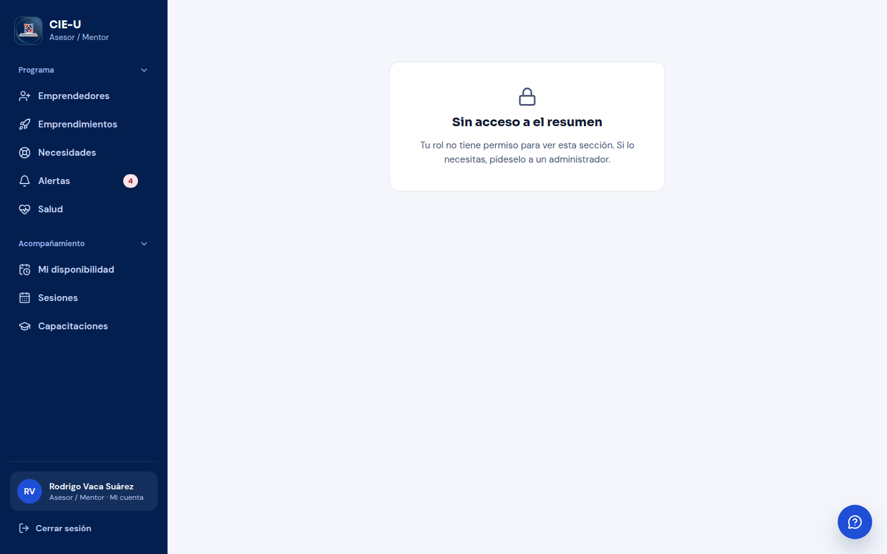

### 5.1.2. Indicadores

**Descripción.** Presenta cifras del programa: emprendimientos por etapa, sesiones realizadas, avances, compromisos vencidos y alertas por tipo. **Acceso:** «Indicadores».

1. Abrir «Indicadores».
2. Elegir las fechas «Desde» y «Hasta» y la etapa («Todas las etapas»).
3. Seleccionar «Aplicar».

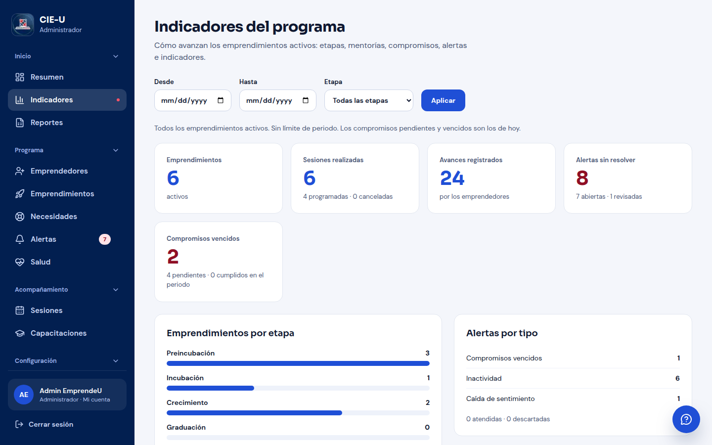

### 5.1.3. Reportes

**Descripción.** Permite revisar y descargar cuatro reportes: «Resumen por emprendimiento», «Sesiones de mentoría», «Alertas» e «Indicadores».

1. Abrir «Reportes» y seleccionar la pestaña del reporte.
2. Elegir el periodo y la etapa, y seleccionar «Aplicar».
3. Revisar la vista previa (hasta 50 filas).
4. Seleccionar «Exportar Excel» o «Exportar CSV».

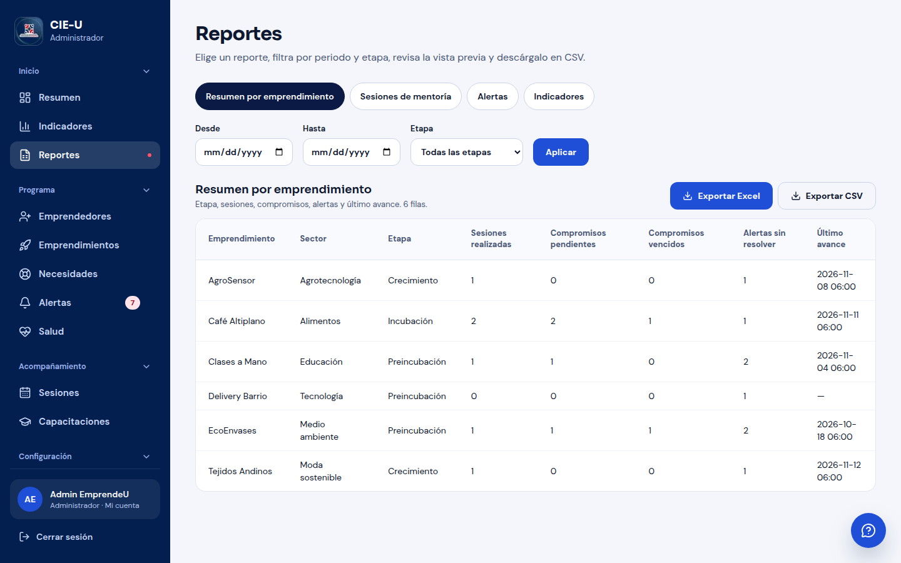

## 5.2. Panel web: Programa

### 5.2.1. Admisiones

**Descripción.** Lista las postulaciones recibidas desde la web pública. **Roles:** coordinación (permiso de registro de emprendedores).

1. Abrir «Admisiones». Filtrar por estado (Pendientes, Admitidas, Rechazadas) o buscar por nombre, correo o emprendimiento.
2. Seleccionar «Revisar» en una postulación.
3. Elegir la decisión: admitir, rechazar o «Mantener pendiente». Si se rechaza, escribir el «Motivo del rechazo»; las «Observaciones» son opcionales.
4. Seleccionar «Confirmar decisión».
5. Al admitir, el sistema crea la cuenta y el emprendimiento y muestra la «Contraseña temporal».

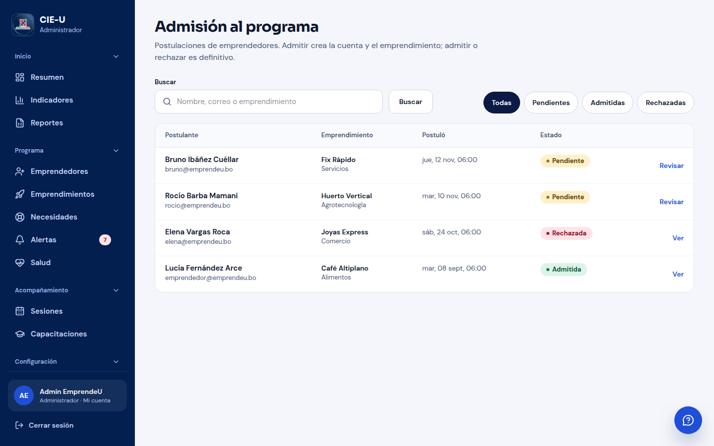

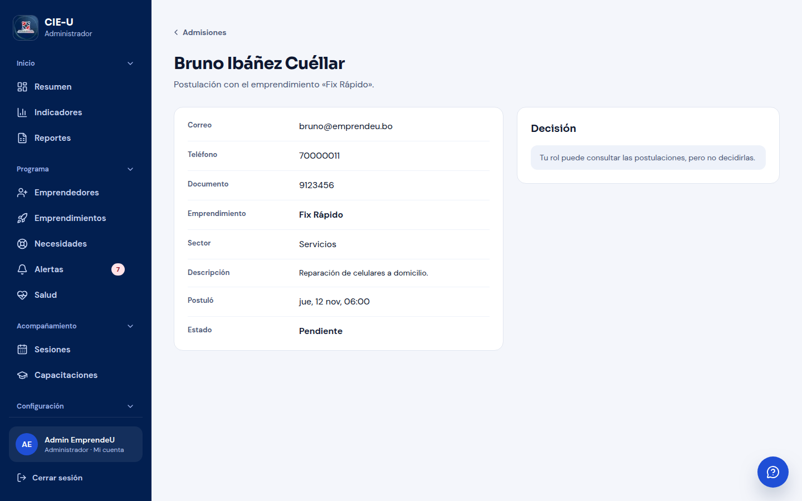

**Restricciones.** Admitir o rechazar es definitivo. Errores frecuentes: «Falta el documento de identidad: no se puede admitir.», «Ese correo ya tiene una cuenta: no se puede crear otra.» y «Ese documento ya pertenece a otro emprendedor.».

### 5.2.2. Emprendedores

**Descripción.** Lista a las personas emprendedoras. El documento de identidad no puede repetirse.

1. Abrir «Emprendedores» y, si hace falta, buscar por nombre, correo o documento.
2. Seleccionar «Nuevo emprendedor».
3. Completar «Nombre completo», «Correo electrónico» y «Documento de identidad».
4. Seleccionar «Registrar emprendedor» y copiar la «Contraseña temporal» mostrada.

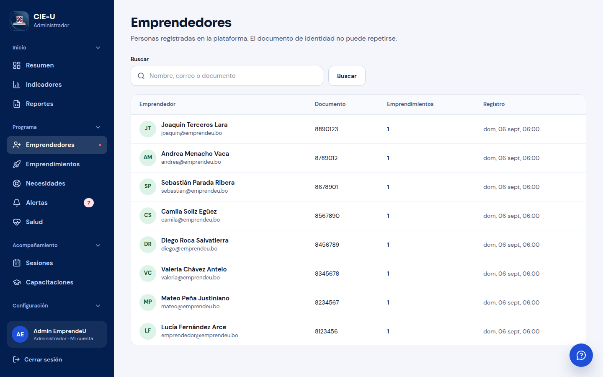

**Errores.** «Ese documento ya está registrado.», «Ese correo ya tiene cuenta.».

### 5.2.3. Emprendimientos

**Descripción.** Gestiona los emprendimientos, su equipo y su etapa. **Roles:** consulta con permiso de emprendedores; crear (registro); editar (modificación); cambiar etapa (modificación de seguimiento).

1. Abrir «Emprendimientos». Filtrar por estado (Todos, Activo, Pausado, Cerrado) o buscar por nombre.
2. **Crear:** «Nuevo emprendimiento» → «Nombre del emprendimiento», «Sector», «Descripción», estado y equipo (cada integrante con su rol: Fundador, Cofundador o Miembro) → «Crear emprendimiento».
3. **Editar:** «Editar» → cambiar los datos → «Guardar cambios».
4. **Equipo:** abrir «Equipo» para agregar o quitar integrantes. El emprendimiento debe conservar al menos un integrante y tiene un máximo de 20.
5. **Cambiar etapa:** «Pasar a…» (o «Avanzar etapa») → revisar los «Criterios de la etapa:» → agregar «Observaciones» (opcional) → confirmar.

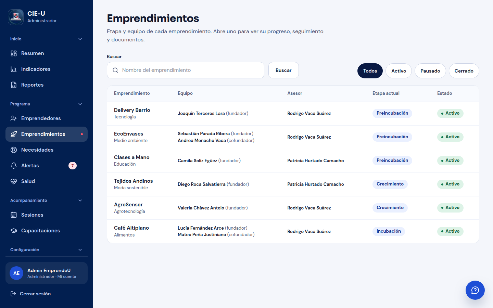

**Restricciones.** La etapa solo avanza a la siguiente etapa activa. Mensajes: «Agrega al menos un emprendedor al equipo.», «Un emprendedor aparece dos veces en el equipo.», «Esa etapa está inactiva.».

### 5.2.4. Ficha del emprendimiento

Al abrir un emprendimiento aparece su ficha con el trayecto de etapas y cinco pestañas.

- **Progreso:** XP acumulado, nivel, insignias, retos cumplidos e historial de XP. Es de solo lectura; los retos los cumple el emprendedor desde la aplicación.
- **Seguimiento:** recomendaciones y compromisos. Con permiso de modificación de asesorías, «Marcar cumplido» cierra un compromiso.
- **Etapas:** historial de cambios de etapa con fecha y observación.
- **Documentos:** archivos del emprendimiento. «Subir documento» acepta PDF, imágenes, texto, hojas de cálculo, documentos y presentaciones; se pueden descargar y eliminar (con permiso).
- **Historial:** eventos del emprendimiento, filtrables por tipo (sesión, avance, hito, recomendación, compromiso y etapa).

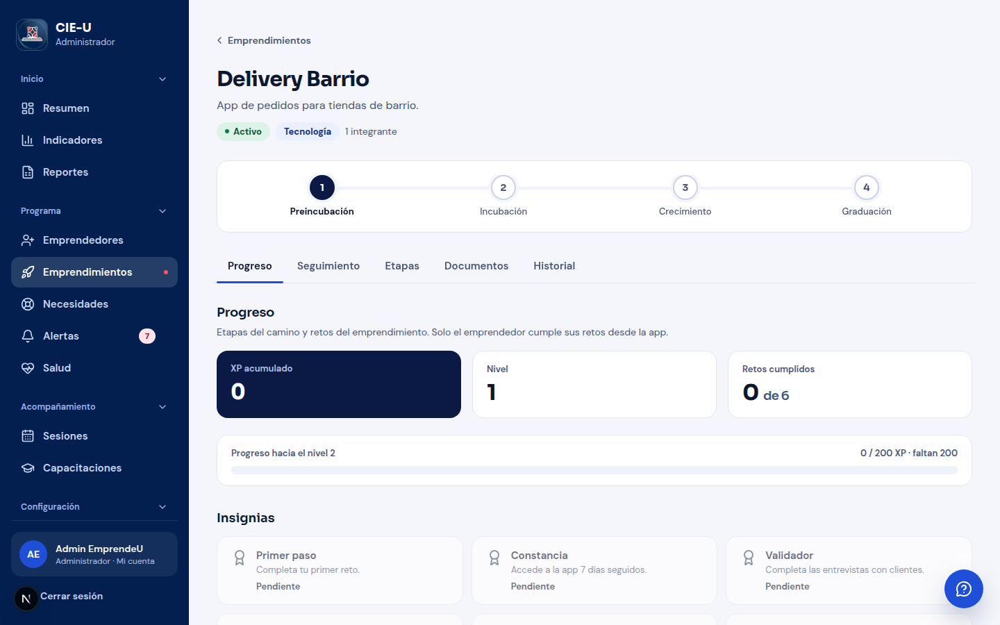

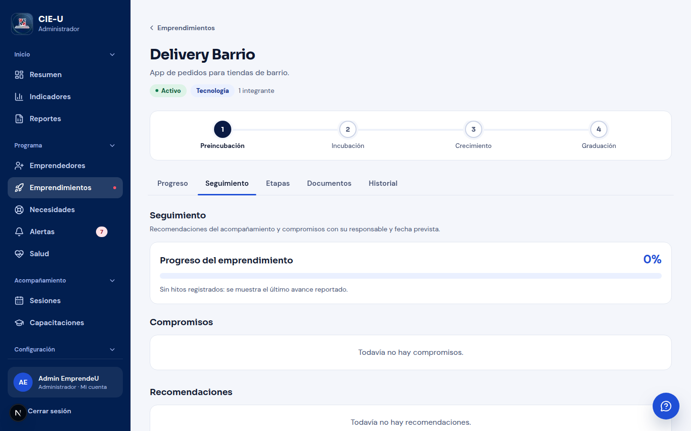

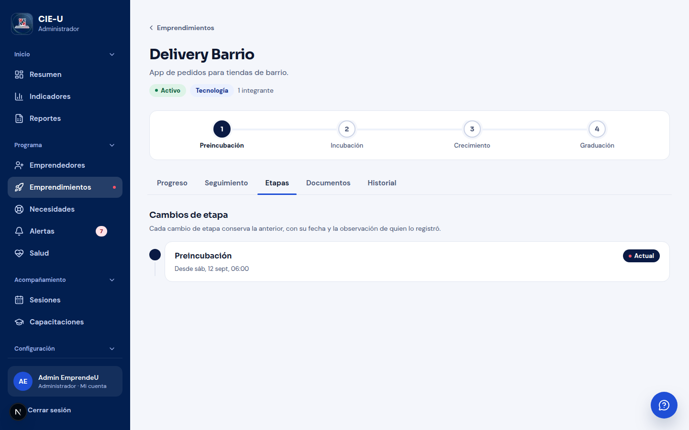

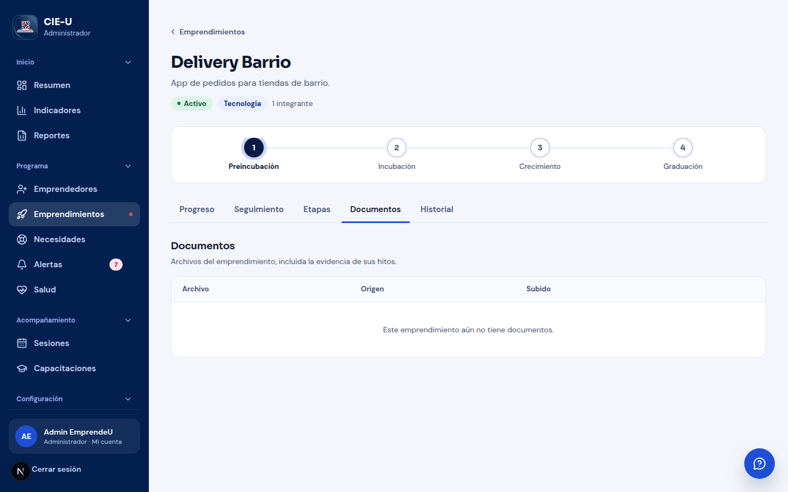

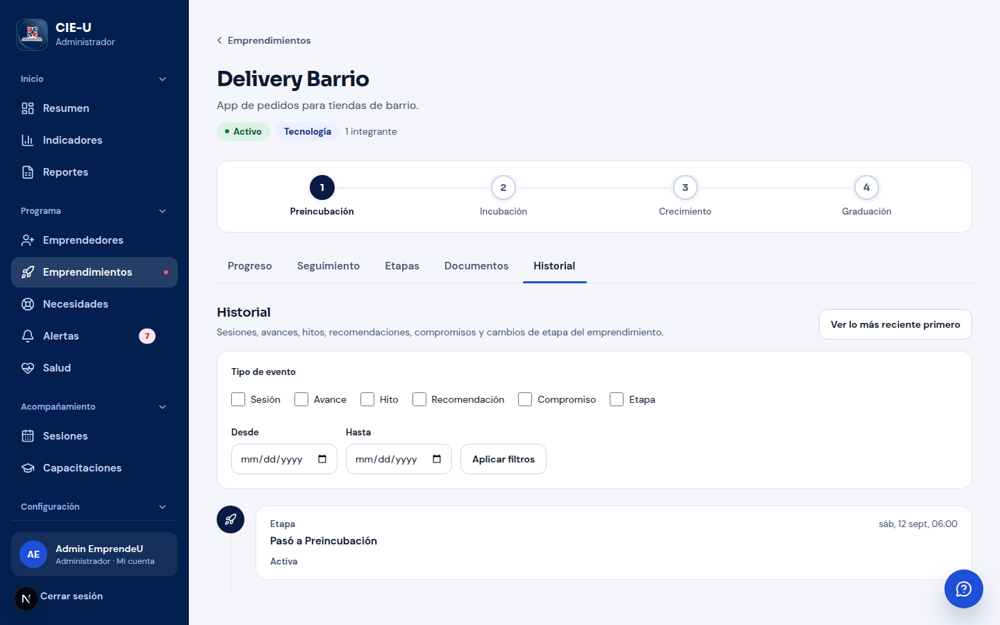

**Errores de documentos.** «Elige un archivo.», «Formato no permitido. Usa: …», «El archivo supera N MB.».

### 5.2.5. Necesidades

**Descripción.** Muestra las necesidades y dificultades que reportan los emprendedores. Las abiertas aparecen primero.

1. Abrir «Necesidades» y filtrar por estado y tipo.
2. Con permiso de modificación de seguimiento, seleccionar la acción de resolver en la fila.
3. El sistema confirma «Resuelta: … Registrado en auditoría.».

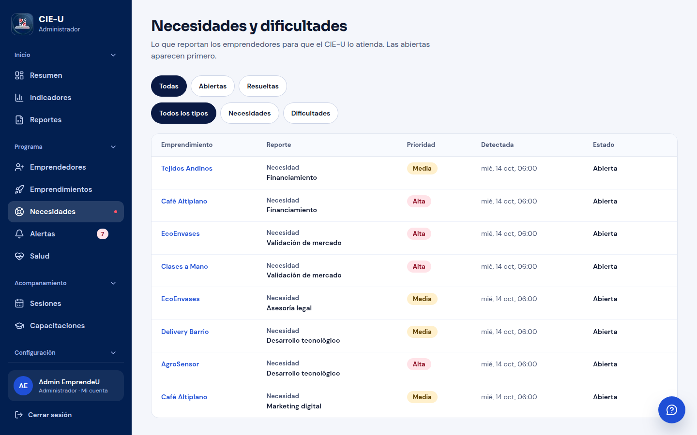

### 5.2.6. Alertas

**Descripción.** Lista los riesgos detectados: inactividad, caída de sentimiento y compromiso vencido. Una alerta no cambia el estado del emprendimiento.

1. Abrir «Alertas» y filtrar por estado (Todas, Abiertas, Revisadas, Atendidas, Descartadas) o por tipo.
2. Abrir una alerta para ver el motivo, la prioridad y la fecha de detección.
3. Con permiso de registro de seguimiento, registrar el seguimiento: la alerta pasa de abierta a revisada y luego a atendida o descartada.

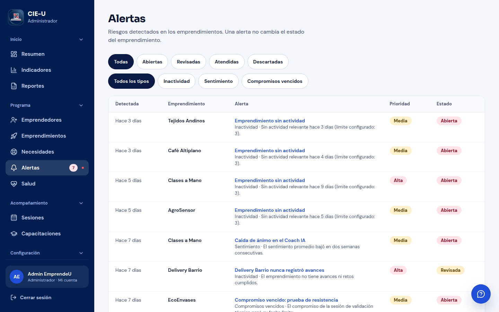

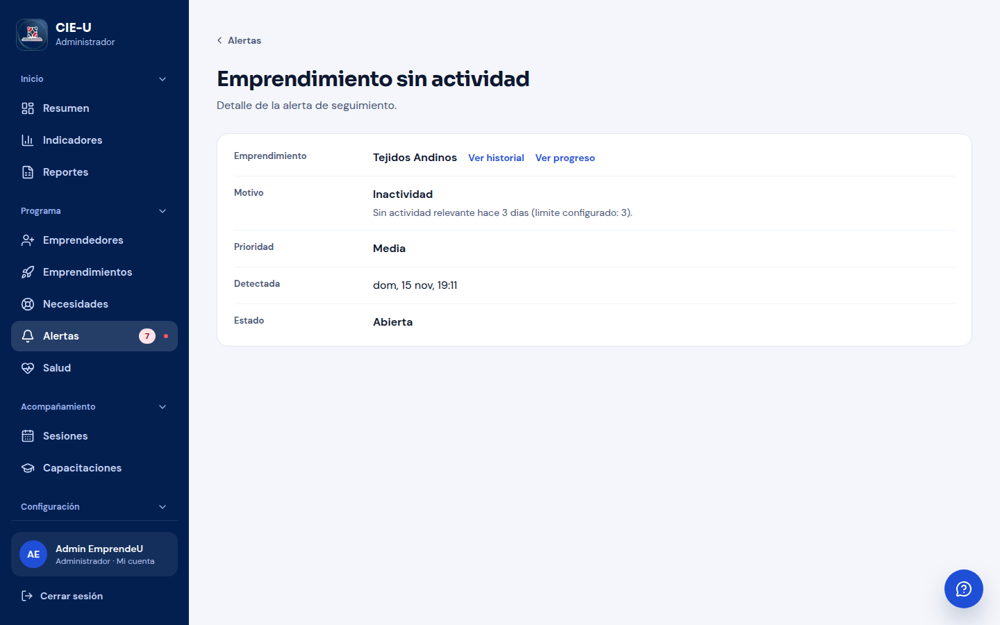

Una alerta ya cerrada no admite nuevos cambios. El asesor ve solo las alertas de sus emprendimientos asignados.

### 5.2.7. Salud de los emprendimientos

**Descripción.** Ordena los emprendimientos del más urgente al que mejor va. El puntaje combina alertas, compromisos vencidos, inactividad, tiempo en la etapa y ánimo en el coach. Verde equivale a 70 o más, ámbar a 40–69 y rojo a menos de 40.

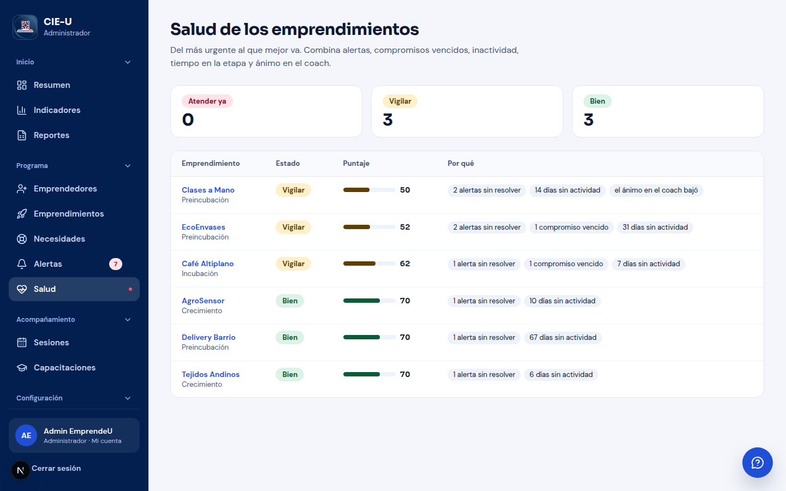

## 5.3. Panel web: Acompañamiento

### 5.3.1. Asignaciones

**Descripción.** Habilita asesores y los asigna a emprendimientos. **Roles:** coordinación (permiso de registro de asesorías); el asesor solo consulta.

1. Abrir «Asignaciones».
2. En «Asesores», activar el interruptor de quien se habilita; solo los asesores habilitados pueden recibir asignaciones.
3. Seleccionar «Asignar asesor», elegir «Asesor» y «Emprendimiento».
4. Seleccionar «Confirmar asignación».

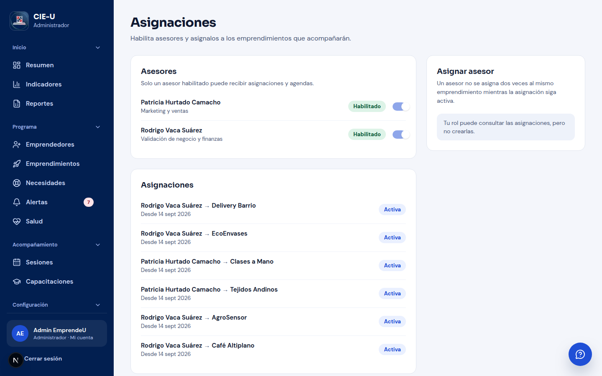

### 5.3.2. Mi disponibilidad

**Descripción.** El asesor define los horarios en los que atiende mentorías, en bloques de 60 minutos. Los emprendedores asignados agendan dentro de ellos.

1. Abrir «Mi disponibilidad».
2. En «Agregar horario», elegir «Día», «Desde» y «Hasta».
3. Seleccionar «Agregar horario».
4. Un horario puede bloquearse («Bloquear este horario»), volver a ofrecerse o eliminarse.

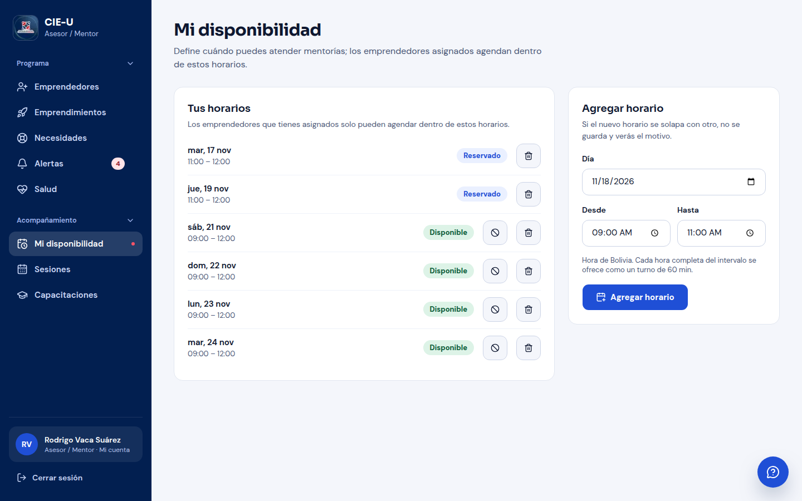

**Validaciones.** «Elige una fecha.», «Elige una hora.», «La hora de fin debe ser posterior al inicio.». Los horarios no pueden superponerse.

### 5.3.3. Sesiones

**Descripción.** Lista las mentorías por estado (Programadas, Realizadas, Canceladas) y periodo, y permite registrar lo ocurrido. El asesor ve sus sesiones; el resto del personal ve todas.

1. Abrir «Sesiones» y aplicar los filtros.
2. **Registrar sesión realizada:** completar Emprendimiento, Tema, Fecha realizada, Hora, Modalidad (Presencial, Virtual, Híbrida) y Observaciones; seleccionar «Registrar sesión».
3. **Nueva recomendación:** escribir Título y Recomendación; seleccionar «Guardar recomendación».
4. **Nuevo compromiso:** elegir Responsable, escribir el Compromiso y, opcionalmente, la Fecha límite; seleccionar «Guardar compromiso». Si no hay fecha se usa el plazo de Parámetros.

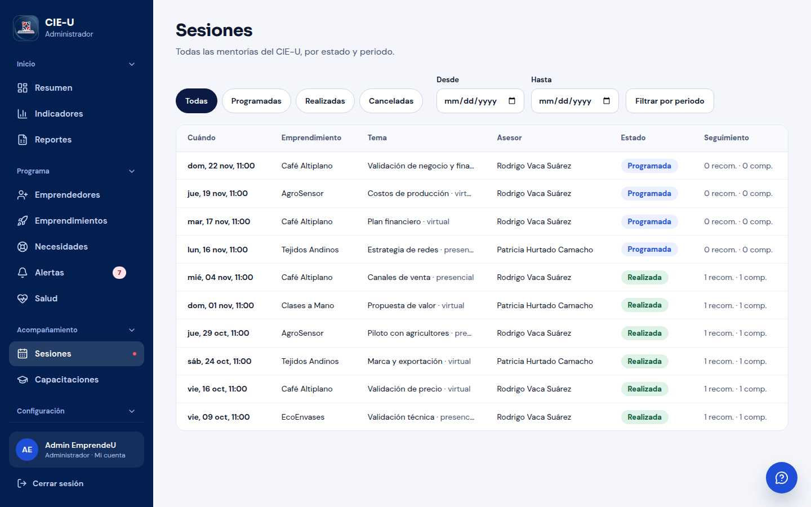

**Restricciones.** Una sesión realizada no puede tener fecha futura. El asesor solo registra en emprendimientos que tiene asignados.

### 5.3.4. Capacitaciones

**Descripción.** Gestiona talleres y charlas, sus participantes y la asistencia.

1. Abrir «Capacitaciones» y filtrar por estado.
2. **Crear:** «Nueva capacitación» → Título, Tipo, Modalidad, Día, Hora, Estado y Descripción → «Crear capacitación».
3. **Editar:** «Editar capacitación» → «Guardar cambios».
4. **Participantes:** abrir la capacitación, buscar con «Buscar emprendedor» y seleccionar «Agregar participante».
5. **Asistencia:** registrar la asistencia o la ausencia de cada participante desde el panel de participantes.

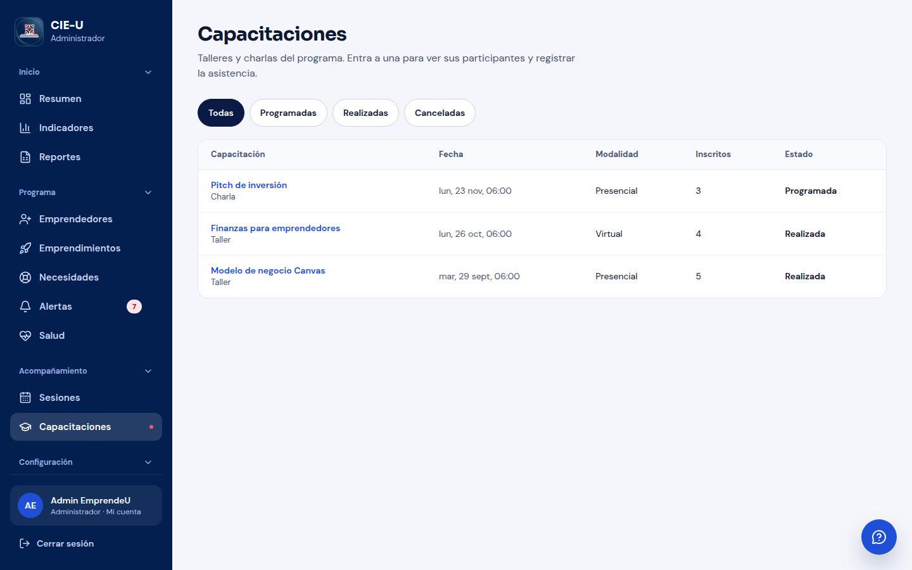

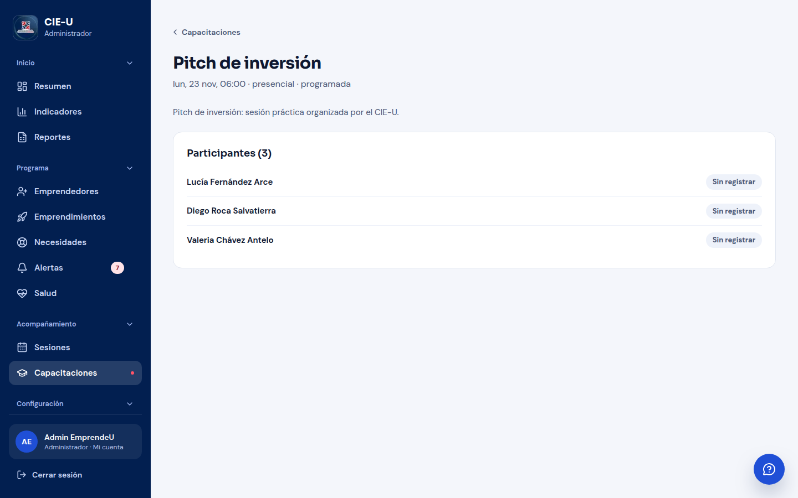

Una capacitación cancelada ya no admite participantes, y un emprendedor no puede repetirse en la misma capacitación.

## 5.4. Panel web: Configuración

### 5.4.1. Usuarios

**Descripción.** Gestiona las cuentas de la plataforma. **Roles:** administrador.

1. Abrir «Usuarios». Buscar por nombre o correo y filtrar por rol.
2. **Crear:** «Nuevo usuario» → «Nombre y apellidos», «Correo», «Rol asignado» → crear y copiar la «Contraseña temporal».
3. **Habilitar o deshabilitar:** usar el interruptor de «Estado de la cuenta».
4. **Cambiar el rol:** elegir el nuevo rol en la columna de rol.

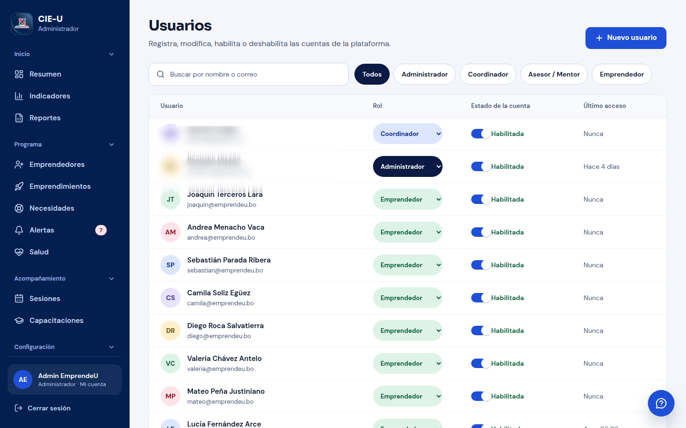

**Validaciones.** «Ingresa nombre y apellido.», «Ya existe una cuenta con ese correo.».

### 5.4.2. Roles y permisos

**Descripción.** Muestra la matriz de siete módulos por cuatro acciones y permite editarla (permiso administrativo de usuarios).

1. Abrir «Roles y permisos» y seleccionar un rol.
2. Marcar o desmarcar las casillas y seleccionar «Guardar cambios». Los cambios rigen de inmediato.
3. **Nuevo rol:** «Nuevo rol» → nombre (mínimo 3 caracteres) y plantilla («Sin permisos» o «Solo lectura»).
4. Los roles personalizados pueden editarse o eliminarse. Un rol con usuarios no puede eliminarse: «Reasigna a sus usuarios antes de eliminarlo».

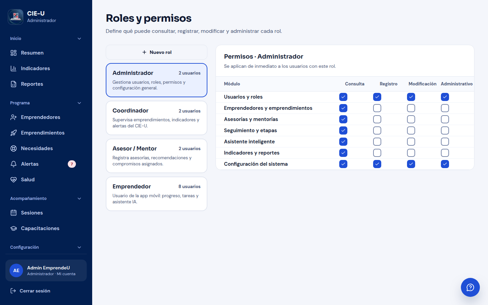

### 5.4.3. Parámetros de seguimiento

**Descripción.** Reglas que usa el sistema para detectar inactividad y riesgo de deserción: «Periodo de inactividad», «Periodos consecutivos para activar», «Caída del índice de sentimiento», «Plazo de los compromisos» e «Incumplimiento de compromisos», con los interruptores «Notificar al asesor asignado», «Notificar al Coordinador del CIE-U» y «Alertas activas».

1. Abrir «Parámetros».
2. Ajustar los valores y revisar el resumen de la derecha.
3. Guardar. El sistema confirma «Parámetros de seguimiento actualizados. Registrado en auditoría.».

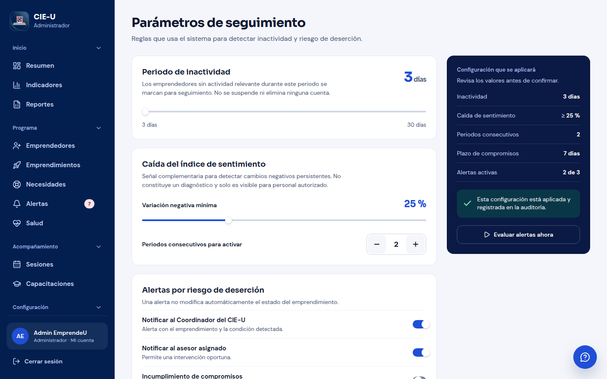

### 5.4.4. Catálogos y XP

**Descripción.** Administra las etapas del ciclo de vida, los retos con sus recompensas de XP y las insignias, en tres pestañas: Etapas, Retos e Insignias. Activar o desactivar una etapa y editar el XP de un reto requiere permiso de modificación de configuración.

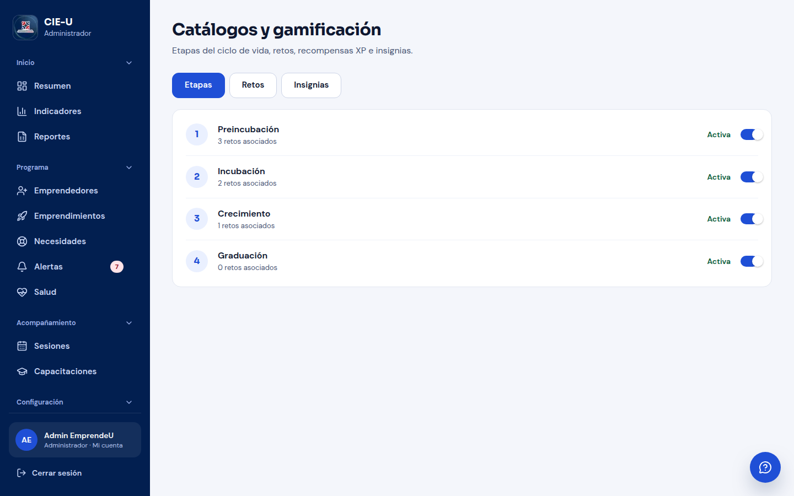

### 5.4.5. Base de conocimiento

**Descripción.** Documentos con los que responde el coach de IA. Solo los activos se utilizan.

1. Abrir «Base de conocimiento».
2. Seleccionar «Subir documento» y elegir el archivo (.txt, .md, .pdf o .docx, de hasta 10 MB).
3. Completar Título, Fuente y Descripción (opcionales) y seleccionar «Subir y procesar».
4. El documento pasa por los estados Procesando, Activo o Error. Un documento activo puede desactivarse.

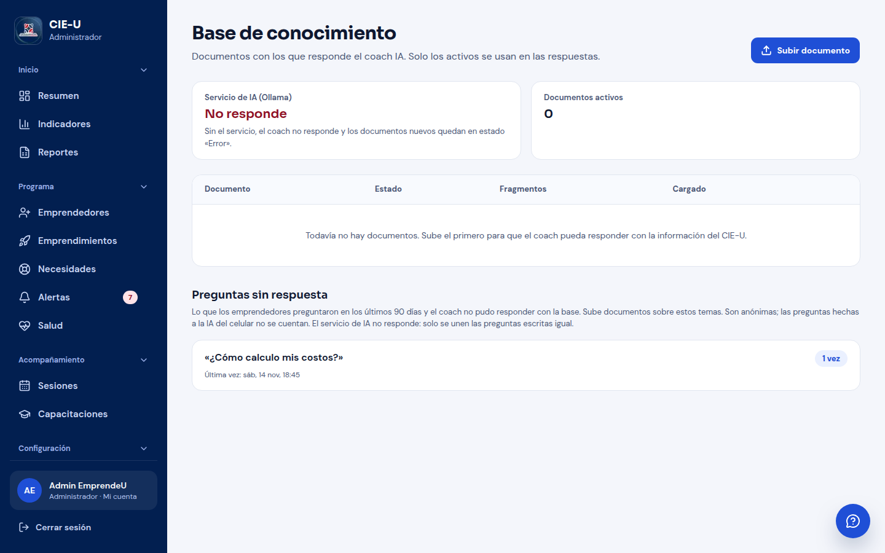

La sección «Preguntas sin respuesta» lista, de forma anónima, las consultas que el coach no pudo resolver.

### 5.4.6. Auditoría

**Descripción.** Registro de acciones sensibles: hora, actor, acción y resultado (Exitoso o Rechazado).

1. Abrir «Auditoría».
2. Filtrar por categoría (Usuarios, Roles, Configuración, Accesos, Negocio).
3. Seleccionar «Exportar CSV» para descargar el registro filtrado.

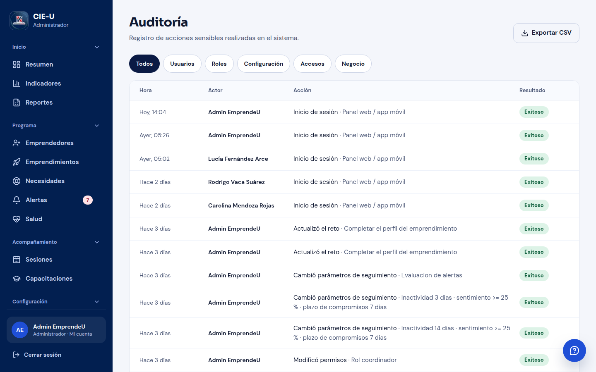

### 5.4.7. Mi cuenta

**Descripción.** Muestra los datos de la sesión y permite cambiar la contraseña. Está disponible para todo el personal.

1. Abrir «Mi cuenta».
2. Escribir la contraseña actual, la nueva y su confirmación.
3. Seleccionar «Cambiar contraseña».
4. El sistema confirma y cierra las demás sesiones abiertas con la contraseña anterior.

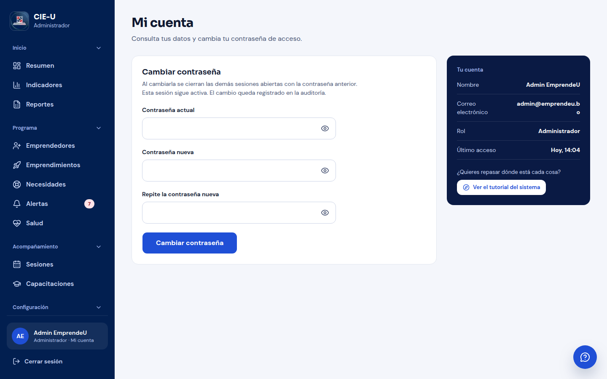

**Validaciones.** «La contraseña actual no es correcta.», «La contraseña nueva debe ser distinta de la actual.», «Las contraseñas no coinciden.».

## 5.5. Panel web: ayuda y tutorial

**Tutorial guiado.** Aparece en el primer ingreso ({{fig:web_tutorial_inicio}}) con los botones «Saltar tutorial» y «Comenzar recorrido». Recorre el menú según los permisos de la persona. Puede repetirse desde «Mi cuenta» con «Ver el tutorial del sistema».

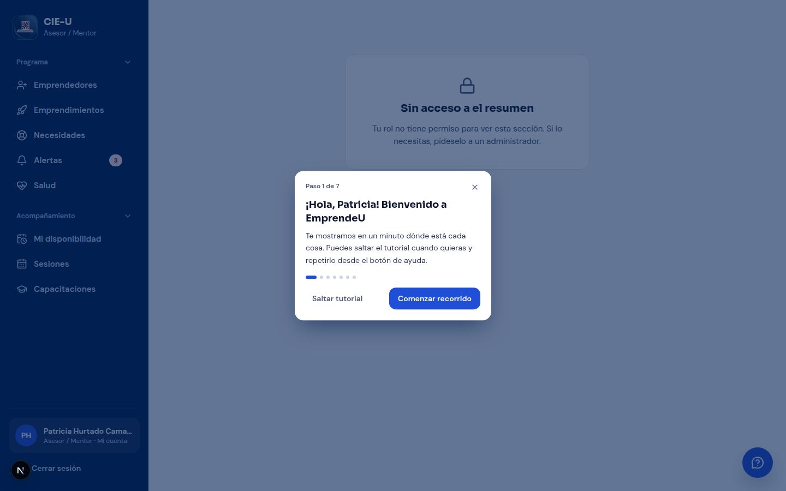

**Asistente de ayuda.** El botón circular de la esquina inferior derecha abre el «Asistente de ayuda». Se puede escribir una pregunta («¿Cómo registro una sesión?») o elegir una sugerencia. Cuando la IA no está disponible responde con una guía rápida y lo indica: «Respuesta de la guía rápida (IA no disponible ahora).».

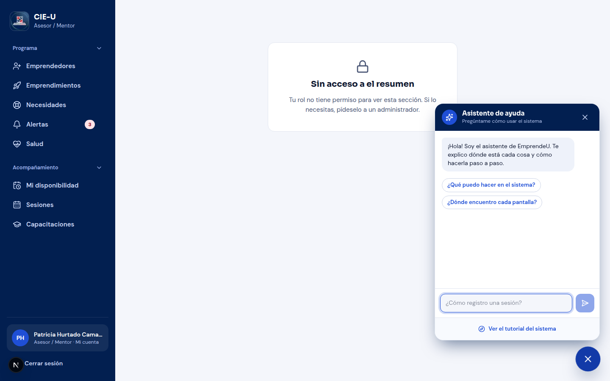

## 5.6. Aplicación móvil

### 5.6.1. Inicio

**Roles:** emprendedor. Muestra el saludo, el estado de conexión («En línea» o «Sin conexión»), la campana de notificaciones, el nivel y el XP, la etapa, el «SIGUIENTE RETO», los «Compromisos pendientes» y «Mis avances». Si no hay emprendimiento registrado, aparece «Registra tu emprendimiento».

1. **Registrar el emprendimiento:** escribir «Nombre del emprendimiento» y tocar «Registrar emprendimiento».
2. **Marcar un compromiso:** tocar la casilla del compromiso. Funciona también sin conexión y queda «Pendiente de sincronizar».
3. **Registrar un avance:** tocar «Registrar avance», describir lo logrado en «¿Qué avanzaste?» y tocar «Guardar».

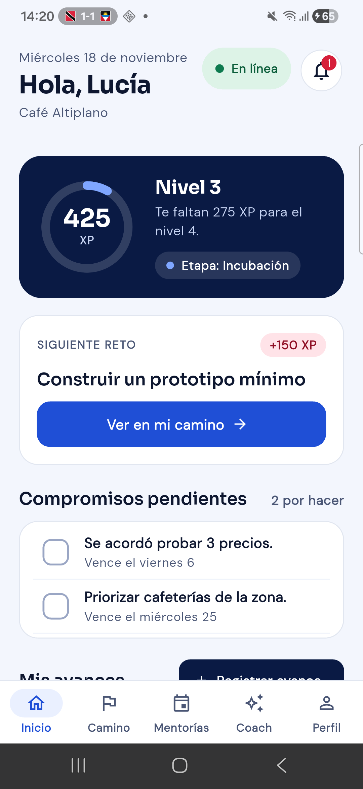

### 5.6.2. Camino

Muestra el mapa de retos del emprendimiento por etapa, con estados Cumplido, En curso y Bloqueado, y los puntos de XP.

1. Abrir «Camino» y tocar un reto.
2. Leer los requisitos. Si es necesario, escribir la «Evidencia» o adjuntar un archivo.
3. Tocar «Marcar como cumplido» (requiere conexión).
4. Aparece una celebración con el XP ganado y, si corresponde, el nuevo nivel o insignia.

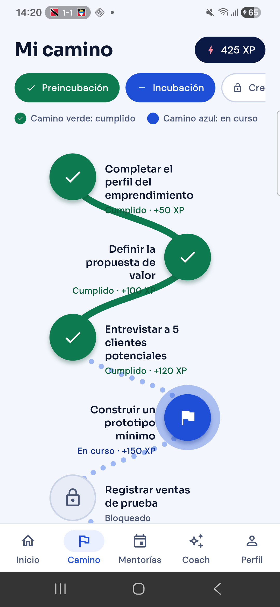

Un reto bloqueado muestra «Completa el reto anterior para desbloquearlo.». El detalle de XP e insignias está en «Ver experiencia e insignias» del Perfil.

### 5.6.3. Mentorías

1. Abrir «Mentorías». Las pestañas «Próximas», «Realizadas» y «Canceladas» filtran la lista; «Filtrar por periodo» acota las fechas.
2. **Agendar:** «Agendar mentoría» → elegir asesor → elegir el día (14 días) → elegir el horario → opcionalmente escribir el «Tema» → «Confirmar mentoría».
3. **Cancelar:** abrir una mentoría programada y tocar «Cancelar mentoría», confirmando el diálogo.
4. **Historial:** «Ver historial del emprendimiento».
5. **Tareas:** «Tareas y compromisos», con los filtros Pendientes, Cumplidas, Compromisos e Hitos.

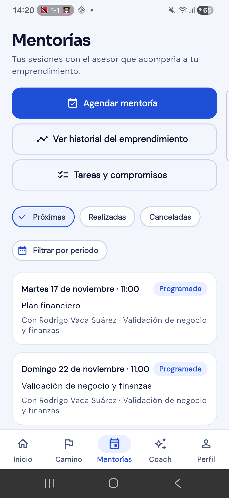

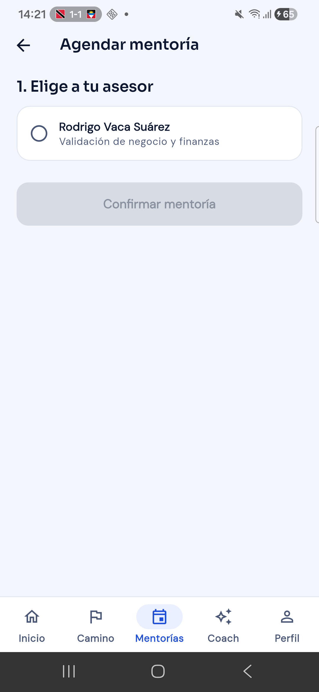

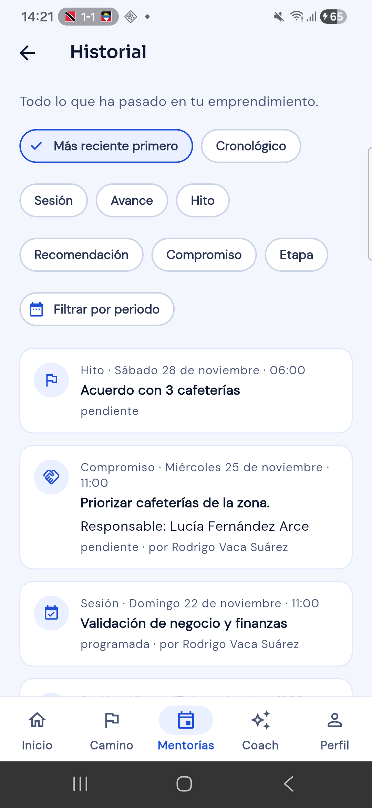

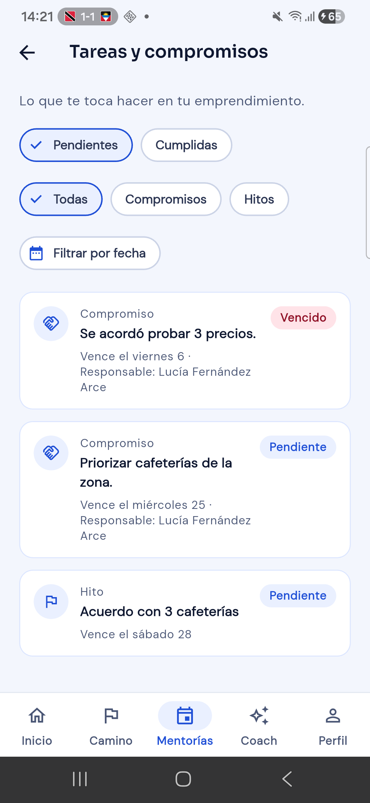

Si no hay asesor asignado: «Todavía no tienes un asesor asignado. El CIE-U te asignará uno cuando tu emprendimiento esté listo.». Si el horario se ocupó: «Ese horario ya no está disponible. Elige otro.».

### 5.6.4. Coach IA

1. Abrir «Coach».
2. Escribir la consulta en «Escribe tu pregunta» o tocar una sugerencia, y tocar «Enviar».
3. La respuesta cita sus «Fuentes». Si no hay información suficiente o el tema es legal o financiero, se ofrece «Agendar una mentoría».
4. «Conversaciones anteriores» muestra el historial y «Nueva conversación» inicia otra.
5. Con la IA instalada, los chips «En tu celular» y «En línea» permiten elegir el modo. «Tus archivos» permite añadir PDF, Word, TXT o MD (hasta 20 MB) que se analizan solo en el teléfono.

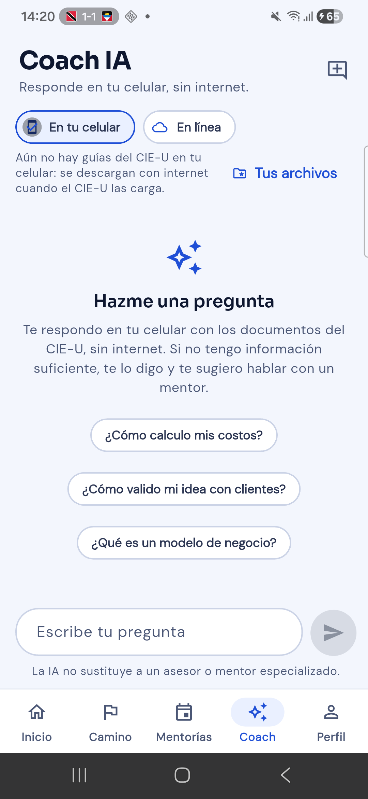

El coach muestra siempre el aviso «La IA no sustituye a un asesor o mentor especializado.». Longitud máxima del mensaje: 2000 caracteres.

### 5.6.5. Perfil

Reúne los datos de la persona, «Mi emprendimiento», el XP, las insignias y los accesos a otras funciones.

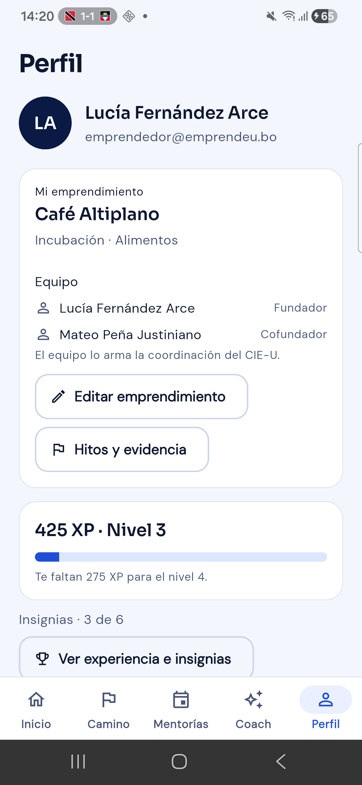

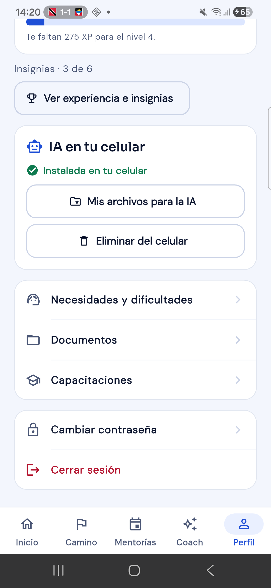

- **Editar emprendimiento:** cambiar nombre, sector y descripción y tocar «Guardar cambios». La etapa y el estado los define la coordinación.
- **Hitos y evidencia:** «Registrar hito» (qué lograste, descripción y evidencia opcional), «Adjuntar evidencia» y «Marcar cumplido».
- **IA en tu celular:** «Descargar IA» (confirmar «Descargar»), «Cancelar descarga» y «Eliminar del celular».
- **Cambiar contraseña:** contraseña actual, nueva y repetición; se cierran las demás sesiones.

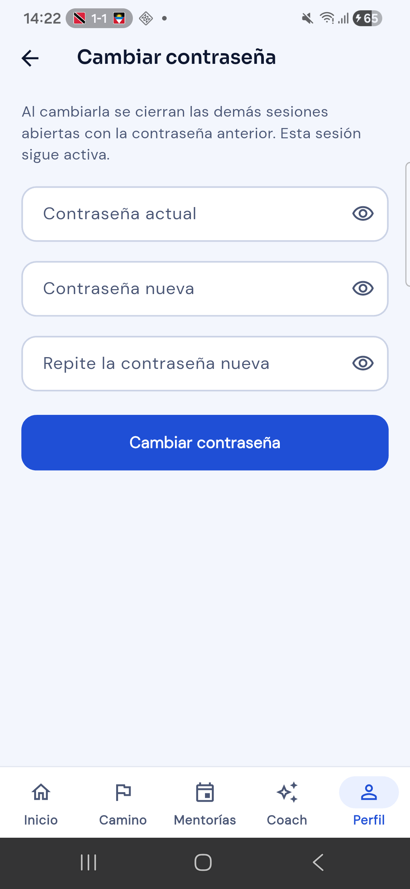

### 5.6.6. Necesidades y dificultades

1. Perfil → «Necesidades y dificultades» → «Reportar».
2. Elegir «Necesidad» o «Dificultad», el «Rubro» y la «Prioridad», y describir el caso en «Descríbelo».
3. Tocar «Enviar reporte». Aparece «Reporte enviado. El CIE-U lo podrá ver.».

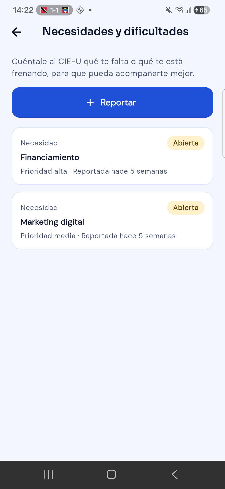

No se puede repetir una necesidad abierta: «Ya reportaste esa necesidad y sigue abierta. Cuando se resuelva podrás reportarla otra vez.».

### 5.6.7. Documentos

1. Perfil → «Documentos».
2. Tocar «Subir documento» y elegir el archivo.
3. Tocar un documento para abrirlo o descargarlo; el ícono de papelera lo elimina tras confirmar.

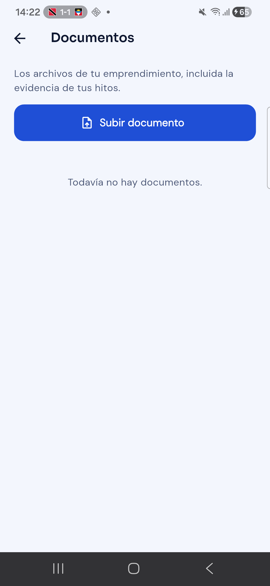

Errores: «Ese tipo de archivo no es válido.», «El archivo es demasiado grande.».

### 5.6.8. Capacitaciones

Perfil → «Capacitaciones». Lista los talleres y charlas. «Inscribirme» inscribe en las programadas; las etiquetas muestran «Inscrito», «Asististe» o «No asististe».

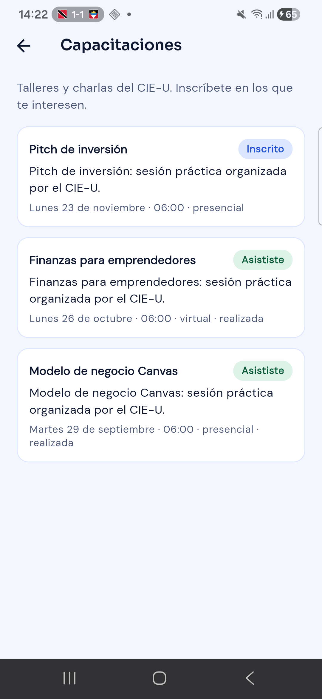

### 5.6.9. Notificaciones

La campana de «Inicio» abre la bandeja «Notificaciones» con avisos de mentorías, compromisos, capacitaciones, etapa e insignias. «Marcar todo leído» limpia los avisos; tocar un aviso abre su pantalla.

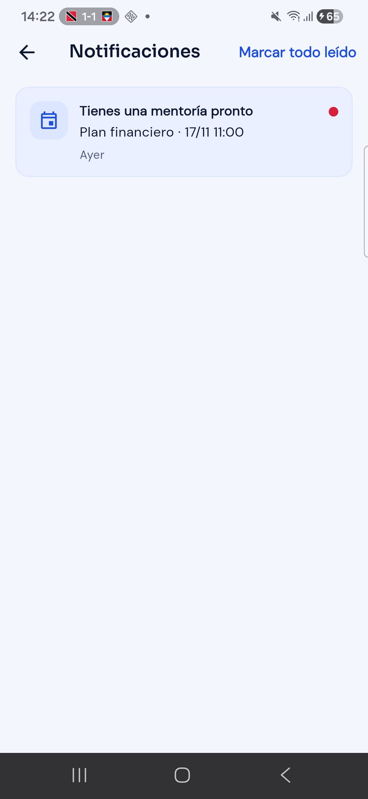

### 5.6.10. Trabajo sin conexión

Los compromisos marcados y los avances registrados sin internet se guardan en el teléfono y se envían al recuperar la red («Sincronizando N registro(s)…», «Todo sincronizado.»). Las demás funciones requieren conexión.

# CAPÍTULO 6. PROCEDIMIENTOS COMPLETOS

## 6.1. Admitir una postulación y acompañar al nuevo emprendimiento

1. La persona postula desde la web pública (sección 3.3).
2. Coordinación abre «Admisiones», revisa y confirma la admisión (5.2.1) y entrega la «Contraseña temporal» a la persona.
3. La persona ingresa a la aplicación móvil (3.2) y cambia su contraseña (5.6.5).
4. Coordinación asigna un asesor al emprendimiento (5.3.1).
5. El asesor define su disponibilidad (5.3.2).
6. La persona agenda su primera mentoría (5.6.3).
7. El asesor registra la sesión, una recomendación y un compromiso (5.3.3).
8. La persona ve el compromiso en «Inicio» y lo marca como cumplido (5.6.1).

*Resultado:* el emprendimiento queda con equipo, asesor, mentorías y compromisos, y su historial lo refleja.

## 6.2. Avanzar un emprendimiento de etapa

1. El emprendedor cumple los retos de la etapa en «Camino» (5.6.2).
2. Coordinación revisa «Progreso» y «Seguimiento» en la ficha (5.2.4).
3. Coordinación usa «Pasar a…» y confirma (5.2.3).
4. La pestaña «Etapas» registra el cambio y el emprendedor recibe una notificación.

## 6.3. Atender una alerta de riesgo

1. Coordinación o asesor abre «Alertas» y filtra «Abiertas» (5.2.6).
2. Abre la alerta, revisa el motivo y el historial del emprendimiento.
3. Registra el seguimiento: revisada, luego atendida o descartada.
4. Si procede, programa una mentoría o un compromiso (5.3.3).

## 6.4. Obtener un reporte para la coordinación

1. Abrir «Reportes» y elegir el tipo (5.1.3).
2. Definir periodo y etapa y aplicar.
3. Revisar la vista previa.
4. Seleccionar «Exportar Excel» o «Exportar CSV».

## 6.5. Recuperar el acceso

Véase la sección 3.4.

# CAPÍTULO 7. MENSAJES Y SOLUCIÓN DE PROBLEMAS

## 7.1. Mensajes informativos

Tabla: Mensajes informativos frecuentes

| Mensaje | Dónde aparece |
|---|---|
| Contraseña actualizada. Ya puedes iniciar sesión. | Tras restablecer la contraseña |
| Recibimos tu postulación. El equipo del CIE-U la evaluará… | Tras postular |
| Reporte enviado. El CIE-U lo podrá ver. | Aplicación, necesidades |
| Cambios guardados. | Aplicación, editar emprendimiento |
| Mentoría cancelada. | Aplicación, mentorías |
| Todo sincronizado. | Aplicación, sincronización |

## 7.2. Mensajes de advertencia

- «Esta decisión es definitiva.» al admitir o rechazar una postulación.
- «¿Cancelar la mentoría?» y «¿Eliminar «…»? No se puede deshacer.»: confirmaciones previas.
- «Sin conexión. Tus registros se guardan en este dispositivo y se sincronizarán después.»

## 7.3. Errores de validación

Tabla: Errores de validación frecuentes

| Mensaje | Causa | Solución |
|---|---|---|
| Ingresa un correo válido. | Formato de correo incorrecto | Escribir un correo completo |
| Usa al menos 8 caracteres. | Contraseña corta | Usar 8 caracteres o más |
| Las contraseñas no coinciden. | La confirmación difiere | Repetir la contraseña igual |
| El código tiene 6 dígitos. | Código incompleto | Escribir los 6 dígitos recibidos |
| Ingresa nombre y apellido. | Nombre de una sola palabra | Escribir nombre y apellido |
| Ese documento ya está registrado. | Documento duplicado | Verificar si el emprendedor ya existe |

## 7.4. Problemas de acceso

Tabla: Problemas de acceso

| Mensaje | Causa | Solución |
|---|---|---|
| Correo o contraseña incorrectos. | Datos erróneos | Revisar; usar la recuperación de contraseña |
| Tu cuenta está deshabilitada. Contacta al CIE-U. | Cuenta deshabilitada | Contactar a un administrador |
| Esta cuenta es de emprendedor: usa la app móvil del CIE-U. | Emprendedor en el panel web | Usar la aplicación móvil |
| Esta cuenta es del panel web del CIE-U. Esta app es para emprendedores. | Personal en la aplicación | Usar el panel web |
| Tu sesión venció. Ingresa de nuevo. | La sesión dura 60 minutos | Ingresar nuevamente |
| Sin acceso a … | Falta el permiso | Pedirlo a un administrador |
| Demasiados intentos. Intenta de nuevo en N min. | Límite de intentos | Esperar el tiempo indicado |

## 7.5. Problemas frecuentes durante el uso

- **«No se pudo conectar con el servidor. Revisa tu conexión.»:** verificar internet e intentar de nuevo.
- **«El servidor tuvo un problema. Intenta de nuevo en unos minutos.»:** esperar y reintentar.
- **«El coach no está disponible en este momento.»:** el mensaje no se envió; reintentar más tarde o usar la IA en el celular si está instalada.
- **No llega el código de recuperación:** revisar la carpeta de correo no deseado y solicitar un código nuevo.
- **No aparece «Agendar mentoría»:** el emprendimiento aún no tiene asesor asignado o habilitado.

## 7.6. Soluciones y recomendaciones

Ante un error persistente, anote el mensaje exacto y la pantalla donde apareció y comuníquese con la coordinación del CIE-U.

# CAPÍTULO 8. BUENAS PRÁCTICAS Y RECOMENDACIONES

## 8.1. Uso adecuado del sistema

Registre avances y compromisos con frecuencia: el sistema usa esa actividad para calcular la salud del emprendimiento y generar alertas por inactividad.

## 8.2. Protección de credenciales

- No comparta su contraseña ni su «Contraseña temporal».
- Cambie la contraseña temporal en el primer ingreso.
- Use una contraseña de al menos 8 caracteres, distinta de la anterior.

## 8.3. Gestión responsable de la información

Suba solo documentos del emprendimiento. Los archivos que se agregan al coach desde «Mis archivos para la IA» se analizan únicamente en el teléfono y se borran al cerrar sesión. Los datos de postulantes y emprendedores deben tratarse con confidencialidad.

## 8.4. Recomendaciones para evitar errores

- Revise los datos antes de confirmar acciones definitivas.
- Confirme que el asesor esté habilitado antes de asignarlo.
- Use Wi‑Fi para descargar la IA en el teléfono.

## 8.5. Consideraciones de seguridad aplicables al usuario

Cierre la sesión en equipos compartidos. Al cambiar la contraseña, las demás sesiones se cierran automáticamente. Las acciones sensibles del personal quedan registradas en «Auditoría».

# CAPÍTULO 9. GLOSARIO DE TÉRMINOS

Tabla: Glosario

| Término | Definición |
|---|---|
| CIE-U | Centro de Innovación y Emprendimiento Universitario. |
| Emprendimiento | Proyecto de negocio acompañado por el programa. |
| Etapa | Fase del programa: Preincubación, Incubación, Crecimiento o Graduación. |
| Reto | Tarea de una etapa que otorga XP al cumplirse. |
| XP | Puntos de experiencia que acumula el emprendedor. |
| Insignia | Reconocimiento por logros del programa. |
| Compromiso | Tarea acordada en una mentoría, con responsable y fecha. |
| Recomendación | Sugerencia que registra el asesor tras una sesión. |
| Hito | Logro del emprendimiento que se registra, con evidencia opcional. |
| Alerta | Aviso de riesgo detectado por el sistema. |
| Coach IA | Asistente de inteligencia artificial que responde con la base de conocimiento del CIE-U. |
| Contraseña temporal | Clave inicial mostrada una sola vez al crear una cuenta. |
| Auditoría | Registro de las acciones sensibles realizadas. |

# CAPÍTULO 10. PREGUNTAS FRECUENTES

**¿Puede un emprendedor entrar al panel web?** No. Debe usar la aplicación móvil.

**¿Quién crea las cuentas del personal?** Un administrador, desde «Usuarios».

**¿Qué pasa si olvido mi contraseña?** Use «¿Olvidaste tu contraseña?» y el código de 6 dígitos enviado por correo; vence en 15 minutos.

**¿Puedo usar el coach sin internet?** Sí, si descargó la IA desde Perfil → «IA en tu celular». Los archivos propios no salen del teléfono.

**¿Por qué no puedo agendar una mentoría?** Porque no tiene asesor asignado o el asesor no tiene horarios disponibles.

**¿Puedo deshacer la admisión de una postulación?** No, la decisión es definitiva.

**¿Qué formatos de reporte existen?** CSV y Excel para los reportes; CSV para la auditoría.

**¿Qué ocurre si registro un avance sin conexión?** Queda guardado en el teléfono con la etiqueta «Pendiente de sincronizar» y se envía al volver la red.

#* REFERENCIAS

Este manual se basa en la inspección directa del sistema y no cita fuentes externas. Su formato adapta las pautas de presentación del siguiente documento:

American Psychological Association. (2020). <i>Publication manual of the American Psychological Association</i> (7.ª ed.). American Psychological Association.

\pagebreak

#* ANEXOS

## Anexo A. Pantallas adicionales por rol

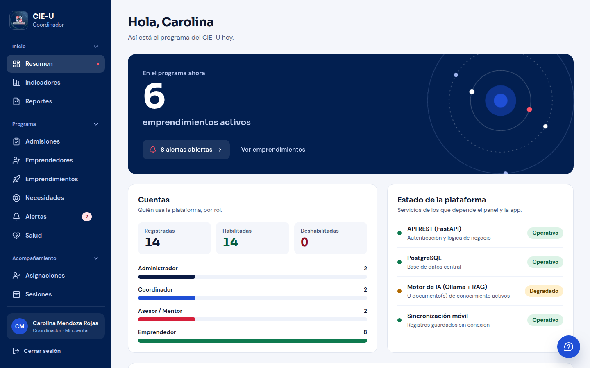

## Anexo B. Capturas y verificaciones pendientes

Tabla: Elementos pendientes de verificar

| Elemento | Estado |
|---|---|
| [CAPTURA PENDIENTE: registro y recuperación de contraseña en la aplicación móvil] | No capturadas; el procedimiento se basa en el código |
| [CAPTURA PENDIENTE: formularios en hoja lateral del panel web (nuevo usuario, nuevo emprendimiento, registrar sesión)] | No capturadas |
| [CAPTURA PENDIENTE: Coach IA con respuesta y fuentes] | No verificado: el servicio de IA estaba desactivado |
| Envío de correos de recuperación y notificaciones push | No verificado en el entorno de prueba |
| Exportaciones CSV/Excel | Presentes en la interfaz; descarga no abierta |

La lista completa está en el archivo `pendientes_verificacion.md`.
